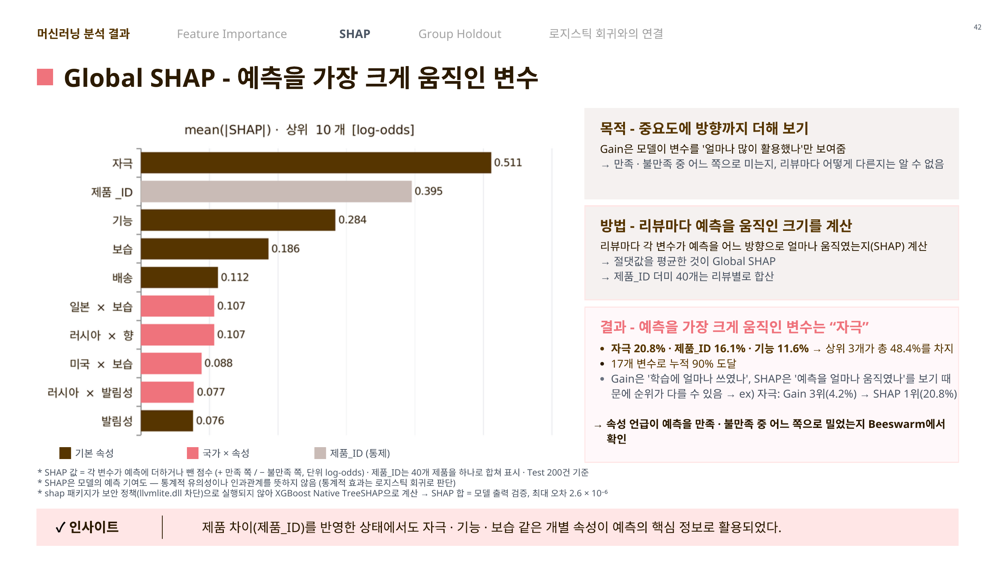
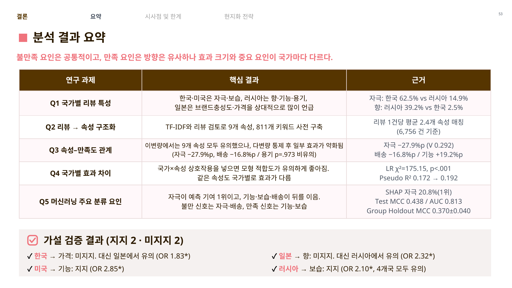
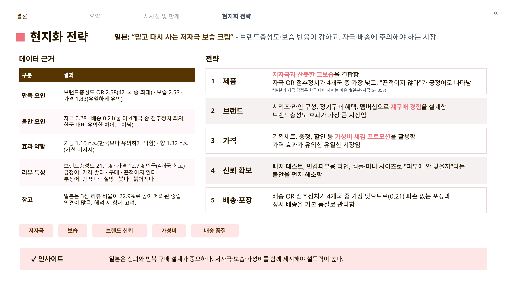

# 🧴 CreamyView — 리뷰 속 소비자는 무엇을 말하는가

> 4개국(한국 · 미국 · 일본 · 러시아) 쇼핑몰의 스킨케어 크림 리뷰를 **텍스트마이닝 · 로지스틱 회귀 · 머신러닝**으로 분석해,
> 국가별로 어떤 제품 속성이 만족 · 불만족과 관련되는지 밝히고 **K-Beauty 현지화 전략**을 제안한 팀 프로젝트입니다.

📄 전체 보고서 : [CreamyView_report.pdf](CreamyView_report.pdf) · 2026 빅데이터 분석 프로젝트 (김지수 · 복헌영 · 손새연 · 임하연)

## 📌 핵심 요약

| 항목 | 내용 |
|---|---|
| **기간 · 인원** | 2026 · 4인 팀 프로젝트 |
| **담당 역할** | 🇯🇵 **일본 파트 전담** — 리뷰 수집 · 전처리 · 토픽 분류 · EDA · SHAP 분석 |
| **사용 기술** | Python · Selenium · Kiwi · statsmodels · scikit-learn · SHAP |
| **데이터** | 4개국 대표 쇼핑몰(올리브영 · Ulta · Rakuten · Wildberries) · 국가별 인기 크림 10개 × 리뷰 200건 |
| **종속변수** | 리뷰의 만족(1) / 불만족(0) |
| **분석 질문** | ① 국가별로 리뷰에서 자주 언급되는 속성은? ② 속성 언급은 만족 · 불만족과 관련이 있는가? ③ 같은 속성의 효과가 국가마다 다른가? ④ 머신러닝은 무엇으로 만족 · 불만족을 가르는가? |
| **주요 기법** | 다국어 번역 · 형태소 분석 · TF-IDF · 키워드 사전 기반 속성 분류 · 로지스틱 회귀(국가 × 속성 상호작용) · 분류 모델 8종 비교 · SHAP · Group Holdout |

#### ✅ 최종 모델
| 항목 | 값 |
|---|---|
| 모델 | XGBoost (주 지표 F1 · CatBoost와 CV F1 차이 0.0013, ROC-AUC · fold 간 변동성에서 우위) |
| 성능 (Test) | F1(만족) 0.819 · MCC 0.438 · ROC-AUC 0.813 |
| 새 제품 일반화 (Group Holdout) | MCC 0.370 ± 0.040 |
| 가장 큰 영향 | 자극 (SHAP 기여 1위, 20.8%) |

## 📊 핵심 그래프

**Global SHAP — 예측을 가장 크게 움직인 변수 (보고서 42쪽)**

**분석 결과 요약 (보고서 53쪽)**

**일본 현지화 전략 (보고서 58쪽)**

## 🔍 분석 흐름

1. **데이터 수집** — 국가별 대표 쇼핑몰에서 인기 크림 리뷰 수집 (별점 높은 순 · 낮은 순 각 100건)
2. **전처리** — 다국어 리뷰 번역 · 정제 · 형태소 분석 · TF-IDF
3. **속성 구조화** — 9개 속성, 811개 키워드 사전 구축 (리뷰 1건당 평균 2.4개 속성)
4. **EDA** — 국가별 만족 · 불만족과 속성 언급 차이 탐색
5. **로지스틱 회귀** — 속성 효과의 통계적 유의성 · 국가별 차이 검증
6. **머신러닝** — 분류 모델 8종 비교 · 튜닝 → XGBoost 선정 · Feature Importance · SHAP · Group Holdout 검증
7. **결론** — 가설 검증 · 시사점 · 국가별 현지화 전략

## 💡 핵심 인사이트

### 1. 불만족 요인은 공통, 만족 요인은 국가마다 다르다
- **자극**(OR 0.28 ~ 0.45)과 **배송**(OR 0.21 ~ 0.45)은 4개국 모두에서 만족 오즈를 크게 낮췄다. SHAP에서도 자극이 예측 기여 1위였다.
- **보습**은 4개국 모두에서 만족을 높였지만, 효과 크기가 달랐다(미국 4.23 > 일본 2.53 > 러시아 2.10 > 한국 1.32).

### 2. 같은 속성도 국가에 따라 효과가 다르다
- 국가 × 속성 상호작용을 넣자 모형 적합도가 유의하게 좋아졌다(LR χ² = 175.15, p < .001, Pseudo R² 0.172 → 0.192).
- 브랜드충성도는 한국에서는 유의하지 않았지만 해외 3개국에서는 모두 유의했고, 향은 러시아에서만 유의했다.

### 3. 가설 검증 — 지지 2 · 미지지 2

| 가설 | 결과 |
|---|---|
| H1 한국 → 가격 | 미지지 (대신 일본에서 유의, OR 1.83) |
| H2 미국 → 기능 | **지지** (OR 2.85) |
| H3 일본 → 향 | 미지지 (대신 러시아에서 유의, OR 2.32) |
| H4 러시아 → 보습 | **지지** (OR 2.10, 4개국 모두 유의) |

### 4. 국가별 현지화 전략

| 국가 | 만족을 끌어올리는 속성 (OR) | 포지셔닝 |
|---|---|---|
| 🇺🇸 미국 | 보습 4.23 · 기능 2.85 · 브랜드충성도 1.84 | 효능이 입증된 고보습 크림 |
| 🇯🇵 일본 | 브랜드충성도 2.58 · 보습 2.53 · 가격 1.83 | 믿고 다시 사는 저자극 보습 크림 |
| 🇷🇺 러시아 | 향 2.32 · 브랜드충성도 2.15 · 보습 2.10 · 발림성 1.97 | 향과 텍스처로 즐기는 감각형 크림 |

- 공통 불만 요인(자극 · 배송)은 표준 운영 품질로 관리하고, 만족 요인은 국가별 소비자 반응에 맞춰 선택적으로 강조한다.

### 🇯🇵 내가 맡은 일본 파트 — "믿고 다시 사는 저자극 보습 크림"

| 구분 | 결과 |
|---|---|
| 만족 요인 | **브랜드충성도 OR 2.58(4개국 중 최대)** · 보습 2.53 · **가격 1.83(가격이 유의한 유일한 시장)** |
| 불만 요인 | 자극 0.28 · 배송 0.21 (둘 다 4개국 중 점추정치 최저, 한국 대비 유의한 차이는 아님) |
| 효과 약함 | 기능 1.15 n.s. · 향 1.32 n.s. → 가설 H3(일본 → 향) 미지지 |
| 리뷰 특성 | 브랜드충성도 21.1% · 가격 12.7% 언급(4개국 최고) · 긍정어 '가격 좋다 · 끈적이지 않다' · 부정어 '안 맞다 · 붓다 · 붉어지다' |

- **전략** : 저자극 + 산뜻한 고보습 제품, 시리즈 · 멤버십 같은 **재구매 설계**, 기획세트 · 증정 같은 **가성비 체감** 프로모션, 샘플 · 미니 사이즈로 "피부에 안 맞을까"라는 불안 해소.
- 일본은 3점(중립) 리뷰 비율이 22.9%로 높아, 분석에서 제외된 중립 의견이 많다는 점을 함께 고려해야 한다.

### ⚠️ 한계
- 별점 높은 순 · 낮은 순을 1:1로 수집해 **실제 별점 분포를 반영하지 않는다.**
- 국가별 플랫폼이 1곳이라 **국가 효과와 플랫폼 효과를 분리할 수 없다.** 중국은 크롤링 제한으로 제외했다.
- 국가별 상위 제품이 서로 달라, 차이를 순수한 문화 효과로 단정할 수 없다.
- 일본어 · 러시아어는 2단계 번역이라 뉘앙스가 손실될 수 있다.
- 상관관계 기반이라 인과를 뜻하지 않는다.
