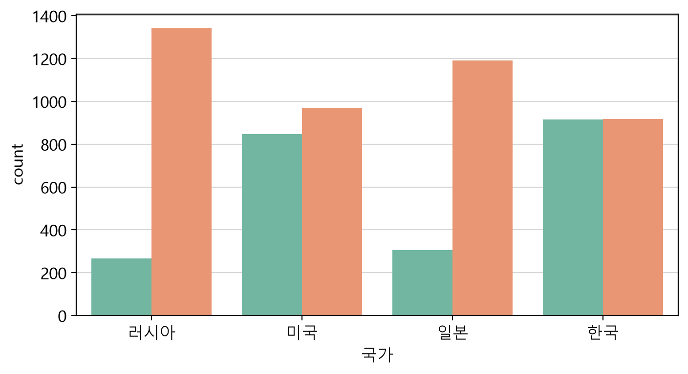
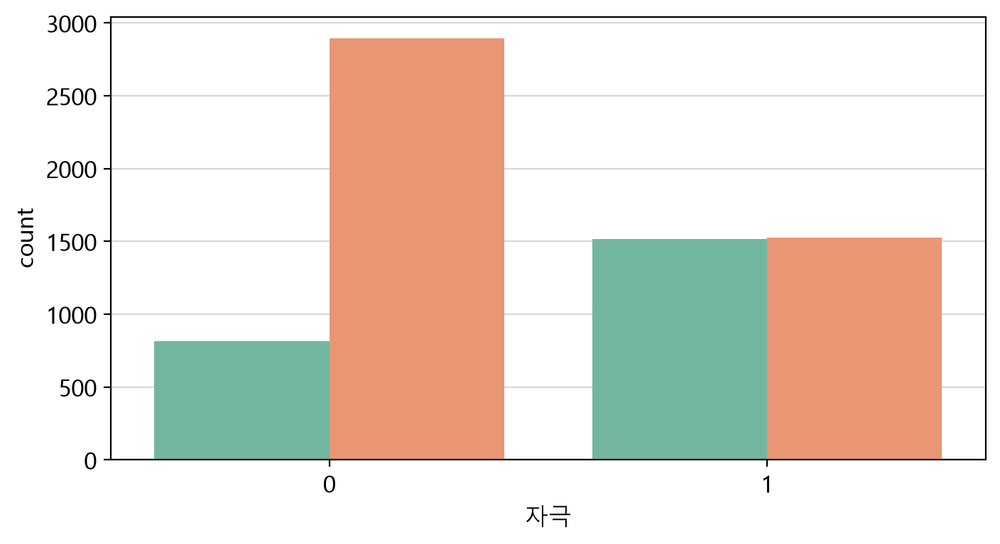
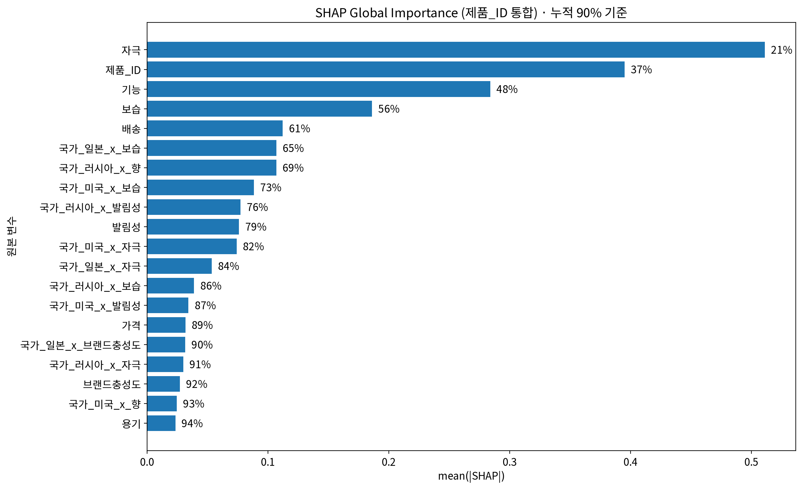
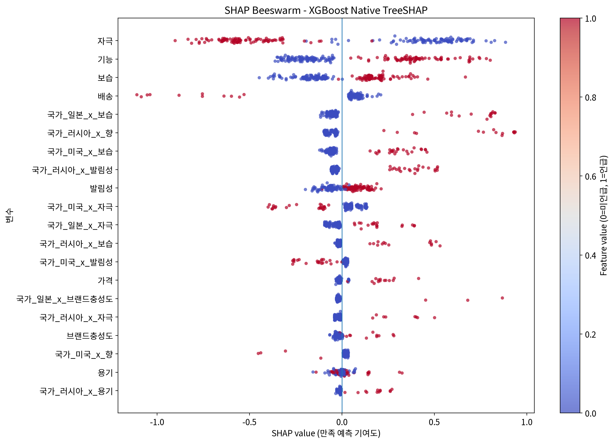
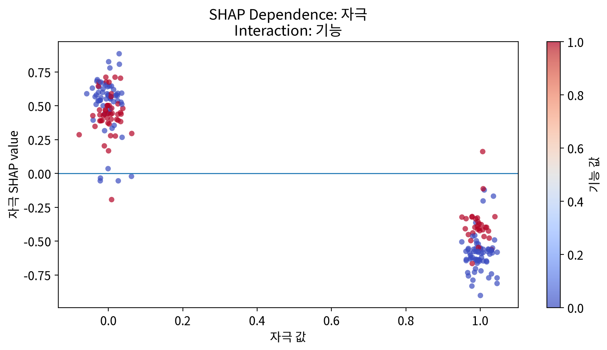
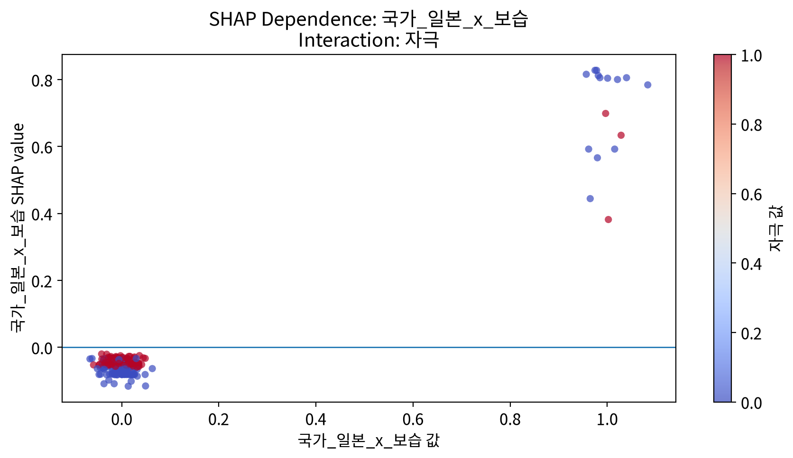

# 🧴 CreamyView — 리뷰 속 소비자는 무엇을 말하는가

> 4개국(한국 · 미국 · 일본 · 러시아) 쇼핑몰의 스킨케어 크림 리뷰를 **텍스트마이닝 · 로지스틱 회귀 · 머신러닝**으로 분석해,
> 국가별로 어떤 제품 속성이 만족 · 불만족과 관련되는지 밝히고 **K-Beauty 현지화 전략**을 제안한 팀 프로젝트입니다.

📄 전체 보고서 : [CreamyView_report.pdf](CreamyView_report.pdf) · 2026 빅데이터 분석 프로젝트 (김지수 · 복헌영 · 손새연 · 임하연)

## 📌 핵심 요약

| 항목 | 내용 |
|---|---|
| **기간 · 인원** | 2026 · 4인 팀 프로젝트 |
| **담당 역할** | 🇯🇵 **일본 파트 전담** — 리뷰 수집 · 전처리 · 토픽 분류 · EDA · SHAP 분석 |
| **사용 기술** | Python · Selenium · Kiwi · statsmodels · scikit-learn · SHAP |
| **데이터** | 4개국 대표 쇼핑몰(올리브영 · Ulta · Rakuten · Wildberries) · 국가별 인기 크림 10개 · 정제 후 리뷰 6,756건 |
| **종속변수** | 리뷰의 만족(1) / 불만족(0) — 만족 4,420건(65.4%) · 불만족 2,336건(34.6%) |
| **통계 모형** | 로지스틱 회귀 (9개 속성 + 국가 × 속성 상호작용) · 우도비 검정 LR χ²(27) = 175.152, p < .001 |
| **머신러닝 모형** | XGBoost · Test F1 0.819 · MCC 0.438 · ROC-AUC 0.813 · 새 제품 MCC 0.370 ± 0.040 |

- **불만족 요인은 공통** : 자극(OR 0.28 ~ 0.45)과 배송(OR 0.21 ~ 0.45)은 4개국 모두에서 만족 오즈를 크게 낮췄다.
- **만족 요인은 국가마다 다르다** : 같은 보습도 미국 4.23 > 일본 2.53 > 러시아 2.10 > 한국 1.32로 효과 크기가 달랐고, 향은 러시아에서만, 가격은 일본에서만 유의했다.
- **머신러닝도 같은 결론** : SHAP 기여 1위는 자극(20.8%)이고, 기능 · 보습 · 배송이 뒤를 이었다.
- **일본(담당)** : 브랜드충성도(OR 2.58) · 보습(2.53) · 가격(1.83)이 만족을 높이는 **"믿고 다시 사는 저자극 보습 크림"** 시장이다.

<br>

---

## 0. 분석 배경 및 목적

- K-Beauty 크림은 해외에서도 많이 팔리지만, 나라마다 소비자가 중요하게 보는 점은 다를 수 있다.
- 리뷰 텍스트를 **9개 제품 속성**으로 구조화하고, 어떤 속성이 만족 · 불만족과 관련되는지 국가별로 비교한다.

| 연구 질문 |
|---|
| ① 국가별로 리뷰에서 자주 언급되는 속성은 무엇인가? |
| ② 속성 언급은 만족 · 불만족과 관련이 있는가? |
| ③ 같은 속성의 효과가 국가마다 다른가? |
| ④ 머신러닝은 무엇으로 만족 · 불만족을 가르는가? |

## 1. 분석 흐름

```
리뷰 수집 → 번역 · 정제 · 형태소 분석 → 9개 속성 사전 구축 → EDA
→ 로지스틱 회귀 (모형 A · B · C) → 가설 검증
→ 머신러닝 (Train CV 비교 · 튜닝 → XGBoost) → Test 평가 · Group Holdout → SHAP 해석 → 국가별 전략
```

---

## 2. 데이터 수집 · 전처리

| 단계 | 내용 |
|---|---|
| 수집 | 국가별 대표 쇼핑몰에서 인기 크림 10개 · 별점 높은 순 · 낮은 순 리뷰 수집 (Selenium) |
| 정제 | 다국어 리뷰 번역 · 정제 · 형태소 분석(Kiwi) · TF-IDF |
| 속성 구조화 | 9개 속성(보습 · 향 · 발림성 · 자극 · 용기 · 배송 · 기능 · 가격 · 브랜드충성도), 811개 키워드 사전 |
| 최종 데이터 | 리뷰 6,756건 · 결측 0건 · 속성이 하나도 없는 리뷰 0건 |

| 국가 | 한국 | 미국 | 러시아 | 일본 |
|---|---|---|---|---|
| 리뷰 수 | 1,832 | 1,818 | 1,608 | 1,498 |

## 3. 탐색적 데이터 분석 (EDA)

### 3-1. 국가별 만족 비율 — 러시아 · 일본은 만족 리뷰가 훨씬 많다



| 국가 | 러시아 | 일본 | 미국 | 한국 |
|---|---|---|---|---|
| 만족 비율 | 83.4% | 79.6% | 53.4% | 50.1% |

- 국가와 만족 여부는 관련이 있다(χ² = 670.510, p < .001, Cramér's V = 0.315 · Moderate).
- 전체 만족 비율이 65.4%라서, **모두 '만족'으로만 예측해도 정확도 0.654**가 나온다. 그래서 정확도만 보지 않고 F1 · MCC를 함께 봤다.

### 3-2. 속성별 만족 비율 — 자극을 언급하면 만족 비율이 절반으로 떨어진다



| 속성 | 미언급 시 만족 비율 | 언급 시 만족 비율 | Cramér's V |
|---|---|---|---|
| 자극 | 78.0% | **50.1%** | 0.292 |
| 기능 | 58.4% | **77.6%** | 0.194 |
| 향 | 62.8% | 78.7% | 0.123 |
| 보습 | 61.0% | 70.7% | 0.101 |
| 배송 | 66.5% | **49.6%** | 0.086 |
| 발림성 | 61.9% | 69.4% | 0.078 |
| 브랜드충성도 | 64.3% | 75.0% | 0.069 |
| 용기 | 64.1% | 70.4% | 0.053 |
| 가격 | 64.8% | 72.6% | 0.044 |

- 9개 속성 모두 만족 여부와 유의하게 관련이 있었다(카이제곱 검정, p < .001).
- 만족 비율을 **낮추는** 속성은 자극 · 배송 두 개뿐이고, 나머지 7개는 언급되면 만족 비율이 올랐다.

### 3-3. 국가별 속성 언급률 — 나라마다 말하는 것이 다르다

| 속성 | 한국 | 미국 | 러시아 | 일본 |
|---|---|---|---|---|
| 자극 | **62.5%** | 55.6% | 14.9% | 43.5% |
| 보습 | 55.5% | **57.0%** | 23.9% | 44.1% |
| 향 | 2.5% | 14.8% | **39.2%** | 10.4% |
| 기능 | 19.0% | 38.0% | **47.8%** | 44.4% |
| 용기 | 12.6% | 14.8% | **35.0%** | 22.1% |
| 가격 | 8.3% | 7.2% | 4.7% | **12.7%** |
| 브랜드충성도 | 7.1% | 8.4% | 7.8% | **21.1%** |

- 한국 · 미국은 **자극 · 보습**, 러시아는 **향 · 기능 · 용기**, 일본은 **가격 · 브랜드충성도**를 상대적으로 많이 언급했다.
- 국가에 따른 차이가 가장 큰 속성은 향(V = 0.369)과 자극(V = 0.365)이다.

---

## 4. 로지스틱 회귀 — 같은 속성도 국가마다 효과가 다르다

### 4-1. 모형 설계

| 모형 | 구성 | 목적 |
|---|---|---|
| A | 국가 더미 3개 + 9개 속성 | 속성의 평균 효과 |
| **B (최종)** | A + **국가 × 속성 상호작용 27개** | 속성 효과가 국가마다 다른지 확인 |
| C | B에서 국가 더미 대신 **제품 고정효과(제품_ID)** | 제품 자체의 차이를 통제해도 결론이 유지되는지 확인 |

- 기준 국가는 한국이다. 국가별 실제 효과는 **속성 계수 + 해당 국가의 상호작용 계수**를 합쳐 오즈비(OR)로 바꿨다.

### 4-2. 상호작용이 필요한가 — 우도비 검정

- 모형 A → B로 상호작용 27개를 넣자 적합도가 유의하게 좋아졌다 : **LR χ²(27) = 175.152, p < .001**
- → 속성의 효과를 4개국 평균 하나로 요약하면 안 된다.

### 4-3. 국가별 오즈비(OR) — 모형 B

| 속성 | 한국 | 러시아 | 미국 | 일본 |
|---|---|---|---|---|
| 보습 | 1.32* | 2.10* | **4.23*** | 2.53* |
| 기능 | 2.13* | 1.34 | **2.85*** | 1.15 |
| 브랜드충성도 | 0.86 | 2.15* | 1.84* | **2.58*** |
| 향 | 1.05 | **2.32*** | 0.91 | 1.32 |
| 발림성 | 1.28* | **1.97*** | 1.05 | 1.30 |
| 가격 | 1.26 | 1.76 | 1.33 | **1.83*** |
| 용기 | 0.97 | 1.31 | 0.77 | 0.98 |
| 자극 | 0.40* | 0.38* | 0.45* | 0.28* |
| 배송 | 0.28* | 0.45* | 0.38* | 0.21* |

<sub>* p < .05 · OR > 1이면 언급될 때 만족 오즈가 커지고, OR < 1이면 작아진다.</sub>

- **자극 · 배송**은 4개국 모두에서 유의하게 만족 오즈를 낮췄다 → 공통 불만 요인
- **보습**은 4개국 모두에서 유의했지만 크기가 달랐다(미국 4.23 ~ 한국 1.32).
- **브랜드충성도**는 한국에서만 유의하지 않았고, **향**은 러시아에서만, **가격**은 일본에서만 유의했다.

### 4-4. 사전 가설 검증 — 지지 2 · 미지지 2, 제품을 통제해도 그대로

| 가설 | 모형 B OR | 모형 C OR (제품 통제) | 판정 |
|---|---|---|---|
| H1 한국 → 가격 | 1.26 (n.s.) | 1.28 (n.s.) | 미지지 · 유지 |
| H2 미국 → 기능 | 2.85* | 3.14* | **지지 · 유지** |
| H3 일본 → 향 | 1.32 (n.s.) | 0.73 (n.s.) | 미지지 · 유지 |
| H4 러시아 → 보습 | 2.10* | 2.21* | **지지 · 유지** |

- 지지 기준 : 예상 방향(OR > 1)이면서 p < .05
- 제품 고정효과를 넣은 모형 C에서도 **4개 가설의 판정이 모두 같았다.** 결과가 특정 제품 때문만은 아니라는 뜻이다.
- 미지지된 가설에서도 단서가 나왔다. 가격은 한국이 아니라 **일본**에서(OR 1.83), 향은 일본이 아니라 **러시아**에서(OR 2.32) 유의했다.

---

## 5. 머신러닝 — 새 리뷰와 새 제품에도 통하는가

### 5-1. 모형 설계 — Test는 마지막에 한 번만

```
Train 70% ── 5-Fold CV ── 베이스라인 11종 비교 → 8종 튜닝 → 최종 모델 선택 → 과적합 진단
Test 30% ── 최종 모델 확정 후 단 한 번 평가
```

| 항목 | 내용 |
|---|---|
| 입력 변수 | 9개 속성 + 국가 × 속성 27개 + `제품_ID`(40개 제품) = 37개 |
| 주 지표 | F1 (만족 클래스) · 보조 MCC · ROC-AUC |
| 기준선 | 모두 '만족'으로 예측 → 정확도 0.654 · F1 0.791 · **MCC 0.000** |

- 베이스라인 비교 · 튜닝 · 모델 선택을 모두 **Train 내부 CV로만** 했다. Test 점수를 보고 모델을 고르면 성능이 낙관적으로 나오기 때문이다.

### 5-2. 튜닝 결과 (Train 5-Fold CV)

| 모델 | CV F1 | F1 표준편차 | CV ROC-AUC |
|---|---|---|---|
| CatBoost | 0.825 | 0.013 | 0.809 |
| **XGBoost** | **0.824** | **0.009** | **0.814** |
| RandomForest | 0.824 | 0.007 | 0.804 |
| Ridge | 0.820 | 0.015 | 0.793 |
| LightGBM | 0.819 | 0.008 | 0.813 |
| Logistic | 0.817 | 0.013 | 0.792 |
| SGD | 0.816 | 0.010 | 0.790 |
| DecisionTree | 0.811 | 0.009 | 0.776 |

- CatBoost가 CV F1 1위였지만 XGBoost와 차이가 0.001에 불과했고, 학습 · 튜닝 시간이 길어 제외했다. 그 결과 **XGBoost**를 최종 모델로 골랐다(`learning_rate` 0.03 · `max_depth` 5 · `n_estimators` 300 · `subsample` 0.8).
- XGBoost는 CatBoost보다 CV ROC-AUC가 높고 fold 간 변동도 작았다.

### 5-3. 과적합 진단 → Test 평가 → 새 제품 검증

| 구분 | F1 | ROC-AUC | MCC |
|---|---|---|---|
| Train | 0.841 | 0.860 | — |
| Train CV | 0.824 | 0.814 | — |
| **Test (리뷰 2,027건)** | **0.819** | **0.813** | **0.438** |
| Group Holdout (새 제품, 20회 반복) | 0.794 ± 0.035 | 0.767 ± 0.025 | 0.370 ± 0.040 |

- Train과 CV의 차이가 F1 0.018 · ROC-AUC 0.046으로 작다. Test 성능도 CV와 거의 같다.
- **Group Holdout** : 학습에 쓰지 않은 제품 12개의 리뷰로 평가했다(`제품_ID` 제외). 성능은 조금 낮아지지만 MCC 0.370으로 기준선(0.000)보다 분명히 높다 → 처음 보는 제품에서도 분류 구조가 어느 정도 유지된다.

---

## 6. 모델 해석 (SHAP)

### 6-1. 전역 영향력 — 자극이 1위



| 순위 | 변수 | mean(\|SHAP\|) | 비중 |
|---|---|---|---|
| 1 | 자극 | 0.511 | 20.8% |
| 2 | 제품_ID (40개 제품 통합) | 0.395 | 16.1% |
| 3 | 기능 | 0.284 | 11.6% |
| 4 | 보습 | 0.186 | 7.6% |
| 5 | 배송 | 0.112 | 4.6% |
| 6 | 일본 × 보습 | 0.107 | 4.4% |

- 원-핫으로 나뉜 제품 더미 40개의 SHAP을 리뷰별로 먼저 합친 뒤 `제품_ID` 하나로 표시했다. 제품_ID는 여러 제품이 섞인 통제 변수라 **방향은 해석하지 않았다.**
- 상위 17개 변수가 전체 기여의 90%를 차지했다.

### 6-2. 방향 — 불만 신호는 자극 · 배송, 만족 신호는 기능 · 보습



- 빨간 점(언급함)이 자극 · 배송에서는 왼쪽(불만족 쪽)에, 기능 · 보습에서는 오른쪽(만족 쪽)에 모여 있다.
- 로지스틱 회귀의 OR 방향(4-3)과 같은 결론이다.

### 6-3. 상호작용 — 기능 언급이 자극 감점을 줄인다



- 자극을 언급하지 않으면 SHAP +0.30 ~ +0.90, 언급하면 −0.10 ~ −0.90이다.
- 자극을 언급한 리뷰 중에서도 **기능을 함께 언급하면(빨강) −0.30 ~ −0.50**, 자극만 언급하면(파랑) −0.50 ~ −0.90으로 감점이 작다.
- → 자극을 겪은 소비자에게는 **'효과가 있었는가'** 가 만족을 가르는 결정 요인이다.

> ⚠️ 이 모델에는 국가 주효과 변수가 없어서, 국가 × 속성 SHAP에는 국가 자체의 만족 수준이 함께 섞여 있다. 그래서 SHAP은 **방향 확인용**으로만 쓰고, 국가 간 효과 크기 비교는 로지스틱 회귀(4-3)를 기준으로 했다.

---

## 7. 결론

### 7-1. 연구 질문별 답변

| 질문 | 답 |
|---|---|
| ① 국가별 언급 속성 | 한국 · 미국은 자극 · 보습, 러시아는 향 · 기능 · 용기, 일본은 가격 · 브랜드충성도를 많이 언급한다. |
| ② 속성과 만족의 관계 | 9개 속성 모두 관련이 있다. 자극 · 배송은 만족을 낮추고, 나머지는 높인다. |
| ③ 국가별 효과 차이 | 상호작용이 유의하다(LR χ² = 175.152). 같은 보습도 미국은 4.23, 한국은 1.32다. |
| ④ 머신러닝의 분류 기준 | 자극이 1위이고 기능 · 보습 · 배송이 뒤를 잇는다. 새 제품에서도 MCC 0.370으로 구조가 유지된다. |

### 7-2. 국가별 현지화 전략

| 국가 | 만족을 끌어올리는 속성 (OR) | 포지셔닝 |
|---|---|---|
| 🇺🇸 미국 | 보습 4.23 · 기능 2.85 · 브랜드충성도 1.84 | 효능이 입증된 고보습 크림 |
| 🇯🇵 일본 | 브랜드충성도 2.58 · 보습 2.53 · 가격 1.83 | 믿고 다시 사는 저자극 보습 크림 |
| 🇷🇺 러시아 | 향 2.32 · 브랜드충성도 2.15 · 보습 2.10 · 발림성 1.97 | 향과 텍스처로 즐기는 감각형 크림 |

- 공통 불만 요인(자극 · 배송)은 모든 시장에서 같은 기준으로 관리하고, 만족 요인은 국가별 반응에 맞춰 선택적으로 강조한다.

### 7-3. 🇯🇵 내가 맡은 일본 파트 — "믿고 다시 사는 저자극 보습 크림"



| 구분 | 결과 |
|---|---|
| 만족 요인 | **브랜드충성도 OR 2.58(4개국 중 최대)** · 보습 2.53 · **가격 1.83(가격이 유의한 유일한 시장)** |
| 불만 요인 | 자극 0.28 · 배송 0.21 (둘 다 4개국 중 점추정치 최저, 한국 대비 유의한 차이는 아님) |
| SHAP (보습) | 보습 미언급 −0.03 ~ −0.12 · 언급 +0.40 ~ +0.85 → 만족 예측을 높임, 자극 여부에 따른 차이는 뚜렷하지 않음 (SHAP은 방향 확인용) |
| 효과 약함 | 기능 1.15 n.s. · 향 1.32 n.s. → 가설 H3(일본 → 향) 미지지 |
| 리뷰 특성 | 브랜드충성도 21.1% · 가격 12.7% 언급(4개국 최고) · 만족 비율 79.6% |

- **전략** : 저자극 + 산뜻한 고보습 제품, 시리즈 · 멤버십 같은 **재구매 설계**, 기획세트 · 증정 같은 **가성비 체감**
- 일본은 3점(중립) 리뷰 비율이 22.9%로 높아, 분석에서 제외된 중립 의견이 많다는 점을 함께 고려해야 한다.

### 7-4. 한계

- 별점 높은 순 · 낮은 순을 1:1로 수집해 **실제 별점 분포를 반영하지 않는다.**
- 국가별 플랫폼이 1곳이라 **국가 효과와 플랫폼 효과를 분리할 수 없다.** 중국은 크롤링 제한으로 제외했다.
- 국가별 상위 제품이 서로 달라, 차이를 순수한 문화 효과로 단정할 수 없다.
- 일본어 · 러시아어는 2단계 번역이라 뉘앙스가 손실될 수 있다.
- 상관관계 기반이라 인과를 뜻하지 않는다.
