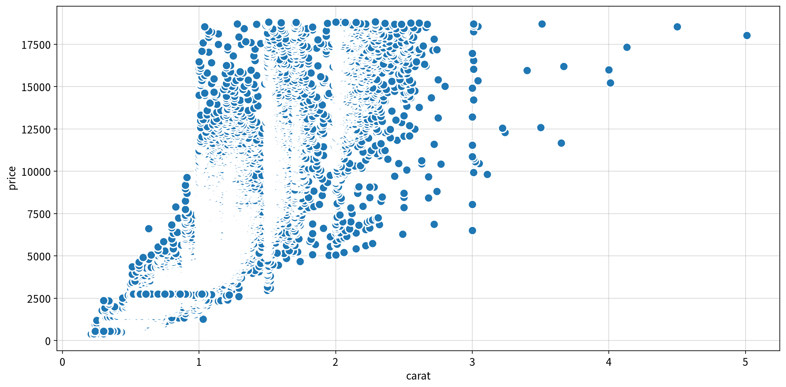
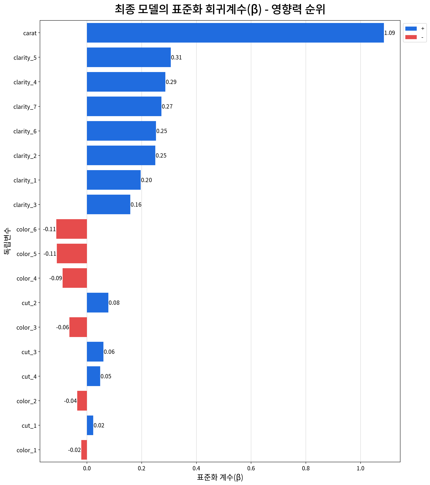
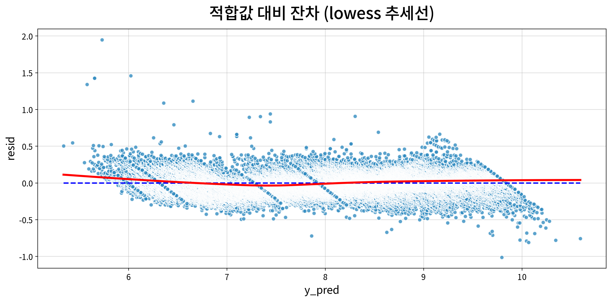

# 💎 다이아몬드 가격 회귀분석 — 등급의 역설과 '도메인 지식 vs 기계적 변수 제거'

> 5.4만 건의 다이아몬드 데이터로 **품질 점검 → EDA → 전처리 조합 비교 → 도메인 지식 모델**을 하나의 흐름으로 수행했습니다.
> EDA에서는 **"등급이 나쁠수록 더 비싸다"는 역설**이 나타났고, 회귀모델로 중량을 통제하자 등급 순서가 정확히 복원됐습니다.

📓 분석 과정 전체(코드 포함) : [다이아몬드 가격 예측.ipynb](<다이아몬드 가격 예측.ipynb>)

## 📌 핵심 요약

| 항목 | 내용 |
|---|---|
| **데이터** | Diamonds · 53,940행 → 중복 146행 · 불가능한 치수 22행 제거 후 53,772행 |
| **종속변수** | `price` 가격 ($) |
| **분석 질문** | ① 가격은 무엇으로 결정되는가? ② 등급(컷·색상·투명도)은 정말 가격을 올리는가? ③ VIF에게 변수 선택을 맡겨도 되는가? |
| **주요 기법** | Spearman 상관 · Welch ANOVA · Games-Howell · 로그-로그 회귀(탄력성) · VIF · 후진소거 OLS · HC3 |

#### ✅ 최종 모델
| 항목 | 값 |
|---|---|
| 모델 | `7_도메인_이상치대체` |
| 형태 | `log(price)` ~ `log(carat)` + cut · color · clarity 더미 (18개) |
| 성능 (달러) | **RMSE 796** · MAE 403 · R² 0.960 (원본 척도) |
| 가장 큰 영향 | `carat` (β = 1.085, 탄력성 1.884) |

## 🔍 분석 흐름

1. **PART 1. 데이터 품질 점검** — `my_qtcheck` + 물리적으로 불가능한 값 제거
2. **PART 2. EDA** — 단변량 → 이변량(등급의 역설) → 다변량
3. **PART 3. 회귀모델링** — 기계적 전처리 vs 도메인 지식 모델, EDA 판정 vs 모델 결과, 최종 보고

## 💡 핵심 인사이트

### 1. 가격은 '중량'이 결정하고, 그 관계는 가파르게 체증한다

  
  

- 로그-로그 모델의 `carat` 탄력성 **1.884**: 중량이 2배면 가격은 약 3.7배.
- 표준화 계수 β = 1.085로 2위(`clarity` VS2, 0.306)의 **3.5배**다. 단일 변수로는 중량의 영향이 압도적이다.

### 2. 단순 평균은 거짓말을 한다 — 등급의 역설
- 평균만 보면 최저 색상 J(5,326달러)가 최고 색상 D(3,173달러)보다, 최저 투명도 I1(3,927달러)이 최고 투명도 IF(2,871달러)보다 비쌌다. **큰 원석일수록 낮은 등급에 몰리는** 교란(confounding) 때문이다.
- 중량을 통제한 회귀에서는 cut · color · clarity **세 등급 모두 순서가 완벽하게 복원**됐다.

### 3. VIF는 '무엇을' 남길지 모른다
- 상관이 거의 같은 크기 변수 넷 중 VIF가 남긴 것은 `z`(깊이)였고, RMSE가 **1,663달러**로 도메인 모델(796달러)의 **2배가 넘었다.**
- 도메인 지식으로 `carat`만 남긴 모델이 **RMSE 796달러로 최고 성능**을 냈다. 크기 변수를 모두 넣은 기계적 최선 모델(RMSE 833달러, 21개)보다 **변수도 3개 적다.**

### 4. 품질 점검이 '불가능한 값'을 잡아냈다
- 기술통계의 최솟값 · 최댓값에서 치수 0mm · 58.9mm · 31.8mm 같은 **물리적으로 불가능한 값**을 찾아, 입력 오류 22행을 제거했다.

### ⚠️ 한계

- 선형성 위배(RESET)가 남아 있다. 중량 구간별로 탄력성이 다를 수 있다(예: 1캐럿 경계 프리미엄).
- 등급 효과는 모든 중량에서 같다고 가정했다. 실제로는 큰 돌일수록 등급 프리미엄이 커질 수 있다(`carat × clarity` 상호작용).
- 성능(RMSE 796달러)은 모델을 학습시킨 데이터로 평가한 값(in-sample)이다. 처음 보는 데이터에서의 예측력은 train/test 분할이나 교차검증으로 확인해야 한다.
