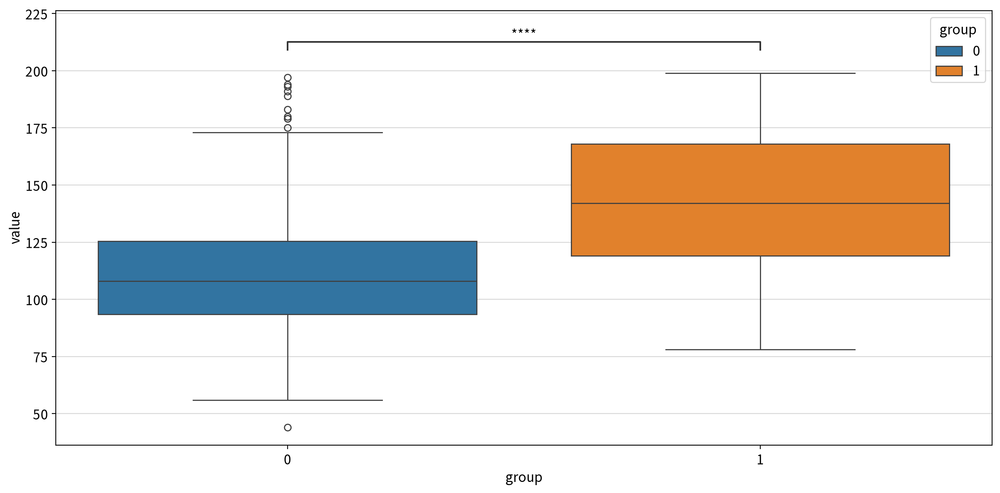
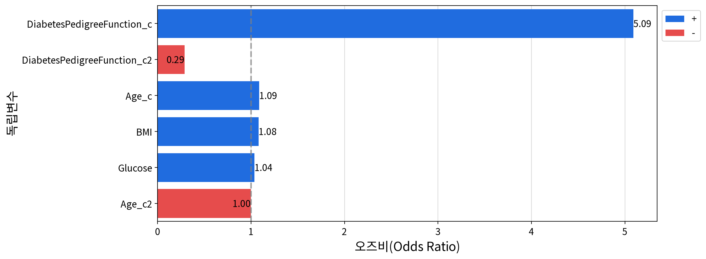
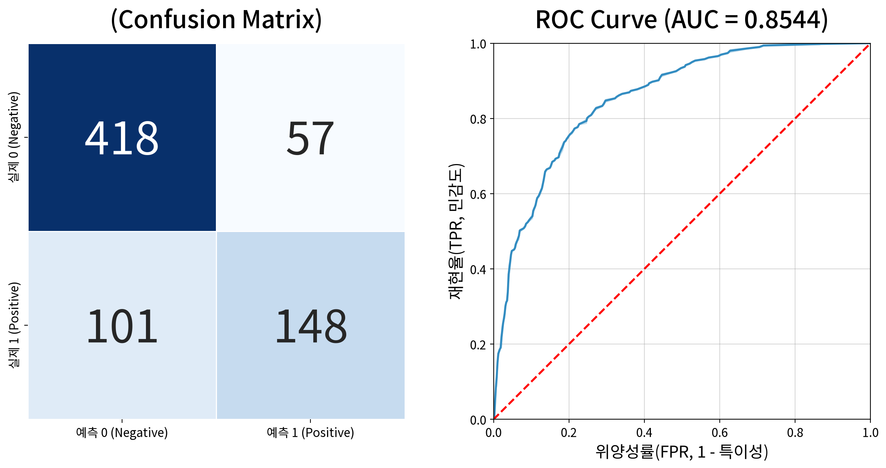

# 🩺 당뇨병 발병 위험요인 분석 — 로지스틱 회귀

> 피마 인디언 여성 724명의 건강 검진 지표로 당뇨병 여부를 판별하는 로지스틱 회귀를
> **품질 점검 → EDA → 기준선 모형 → 가정 검정(로짓 선형성) → 체크포인트 비교 → 최종 보고**의 흐름으로 수행했습니다.
> 직선을 가정한 기준선 모형에서 **나이는 유의하지 않았지만**(p = 0.085), 가정 검정으로 **'오르다가 꺾이는' 곡선 관계**가 드러나자 혈당 다음으로 강한 위험요인이 됐습니다.
> 또 정확도(0.78)만 보면 좋은 모델이지만 **당뇨 환자의 40%를 놓친다**는 점을 확인하고, 선별검사 목적에 맞게 임계값을 조정했습니다.

📓 분석 과정 전체(코드 포함) : [당뇨병_발병_요인_분석.ipynb](당뇨병_발병_요인_분석.ipynb)

## 📌 핵심 요약

| 항목 | 내용 |
|---|---|
| **데이터** | [Pima Indians Diabetes (Kaggle)](https://www.kaggle.com/datasets/uciml/pima-indians-diabetes-database) · 768행 → 결측 처리 후 724행 × 6개 지표 |
| **종속변수** | `Outcome` — 당뇨(1) 249명 / 정상(0) 475명 (34 : 66, 불균형) |
| **분석 질문** | ① 당뇨병 발병과 관련된 위험요인은 무엇인가? ② 나이의 위험은 직선적으로 늘어나는가? ③ 선별검사로 쓰려면 판정 기준(임계값)을 어떻게 정해야 하는가? |
| **주요 기법** | Mann-Whitney U · Box-Tidwell 로짓 선형성 검정 · 중심화 제곱항 · 후진소거 · AUC · 임계값 조정 |

#### ✅ 최종 모델
| 항목 | 값 |
|---|---|
| 모델 | `5_가정반영+후진소거` |
| 형태 | `logit(P(당뇨))` ~ `Glucose` + `BMI` + `Age` (1차 · 제곱) + `DiabetesPedigreeFunction` (1차 · 제곱) |
| 성능 (임계값 0.5) | 정확도 0.782 · AUC 0.854 · 재현율 0.594 · Pseudo R² 0.305 |
| 권장 임계값 (선별검사) | 0.3 → 재현율 0.819 · F1 0.703 |
| 가장 큰 영향 | `Glucose` (β = 1.111) |

## 📊 핵심 그래프

**발병 여부에 따른 포도당(Glucose) 수치 비교**

**최종 모델의 오즈비(Odds Ratio)**

**혼동행렬과 ROC 곡선 (AUC 0.854)**

## 🔍 분석 흐름

1. **PART 1. 데이터 품질 점검** — 숨어 있는 결측치(0값) 찾기 · 결측 처리 · 기술통계
2. **PART 2. EDA** — 단변량(불균형 확인) → 이변량(집단 비교) → 다변량(공선성) → 최종 변수 선택
3. **PART 3. 기준선 모형과 가정 검정** — 기준선 모형 → 로짓 선형성 진단 → 처방 루프 → 독립성
4. **PART 4. 로지스틱 회귀 모델링** — 전처리 체크포인트 비교 → 최종 모델 선택
5. **PART 5. 최종 모델 보고** — 계수 해석 · 분류 성능 · 임계값 조정

## 💡 핵심 인사이트

### 1. 당뇨 위험의 4대 요인은 혈당 · 나이 · 가족력 · 체중
- 표준화 계수 β 기준 **`Glucose`(1.111) > `Age`(0.988) > `DiabetesPedigreeFunction`(0.541) > `BMI`(0.532)** 다.
- 혈당이 10mg/dL 높으면 당뇨 오즈가 약 43%, BMI가 1 높으면 약 8% 증가한다.

### 2. 직선 모형은 나이의 위험을 지웠다
- 기준선 모형에서 나이는 **유의하지 않았다**(p = 0.085). 직선만 가정하면 그대로 제거됐을 변수다.
- 로짓 선형성 검정이 '직선이 아니다'를 잡아냈고, 제곱항을 넣자 **오르다가 꺾이는 ∩자 관계**가 드러나 **β 2위의 위험요인**이 됐다.
- 동시에 **임신 횟수의 효과는 사라졌다.** 나이와 얽혀 있던 임신 횟수가 직선 모형에서 나이의 효과를 대신 짊어지고 있었던 것이다.
- → **가정 검정은 형식적인 절차가 아니라 결론을 바꾸는 단계**다.

### 3. 자동 선택은 가정을 모른다
- `compare_models()`는 **`2_이상치대체`를 1순위**로 골랐다. AUC가 최고 모델과 1.72% 차이로 5% 이내이고, 변수가 4개로 가장 적었기 때문이다. 하지만 이 모델은 **로짓 선형성 처방을 반영하지 않아, 나이가 '유의하지 않다'며 지워진 모델**이다.
- 따라서 가정을 충족한 모델 안에서, 처방(제곱항)을 지우지 않은 **`5_가정반영+후진소거`** 를 최종 채택했다.
- → **성능 비교표의 1순위는 출발점일 뿐, 가정과 원칙에 비춰 분석자가 검토해야 한다.**

### 4. 정확도 0.78의 함정 — 환자의 40%를 놓친다
- 정상인이 2배 많은 불균형 데이터라, 게으른 모델도 정확도 65.6%가 나온다.
- 기본 임계값(0.5)에서는 **당뇨 환자 249명 중 101명을 놓친다**(재현율 0.594).
- **선별검사 목적이라면 임계값을 0.3으로 낮춰** 놓친 환자를 45명으로 줄이는 것이 맞다(재현율 0.819, F1 최대).

### ⚠️ 한계
- **고령 구간의 해석에 주의해야 한다.** 일정 나이를 넘으면 위험이 낮아지는 곡선은, 고령 표본이 적고 이미 발병한 고령자가 빠진 **표본 특성**일 가능성이 크다.
- **처방이 자동 규칙(AIC)으로 정해졌다.** 가족력 지수는 제곱항이 선택됐지만, 의학적으로는 '가족력이 강할수록 위험이 계속 오른다'는 로그 형태가 더 자연스럽다. 꼭대기 이후 구간은 표본이 적어 불안정하다.
- **결측 처리로 정보를 잃었다.** 인슐린(48.7%) · 피부두께(29.6%)를 제거했는데, 인슐린은 당뇨와 직접 관련된 지표다. 결측 대체(다중대체 등)를 시도해 볼 수 있다.
- **특정 집단의 데이터다.** 21세 이상 피마 인디언 여성만 포함되어, 다른 인종 · 성별에 그대로 일반화할 수 없다.
- **성능을 학습 데이터에서 측정했다(in-sample).** train/test 분할이나 교차검증으로 확인해야 한다.
- **인과관계가 아니라 연관관계다.**
