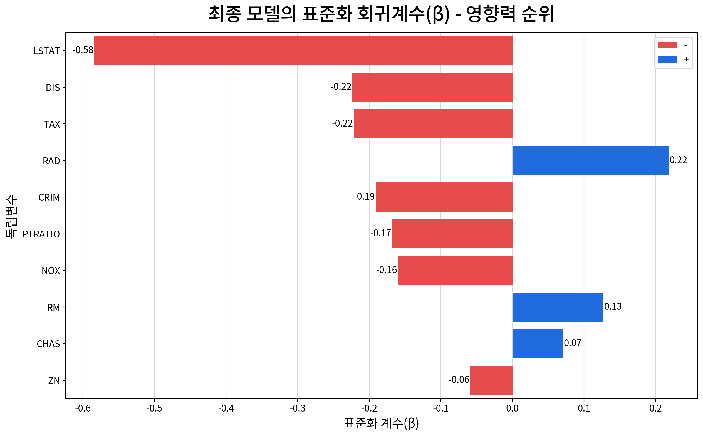
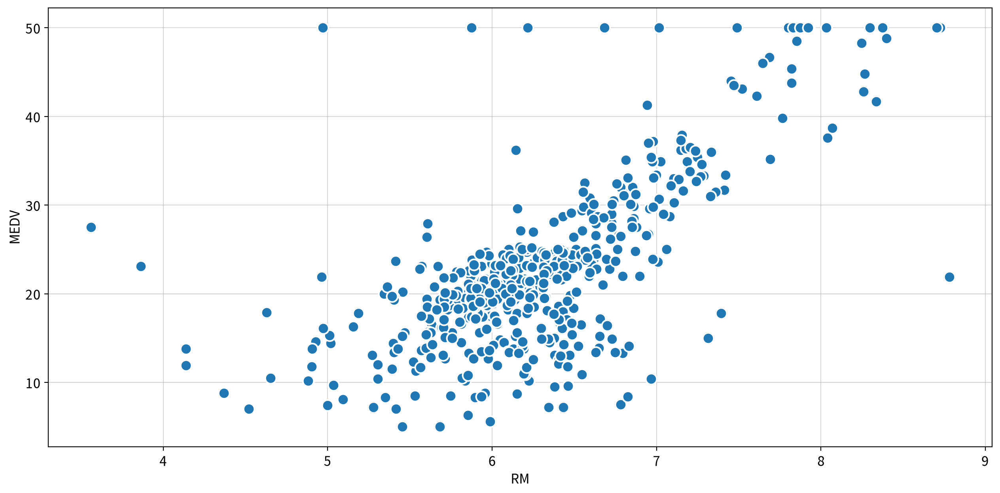
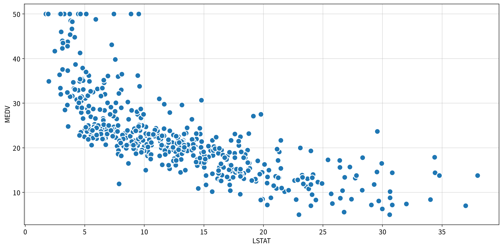

# 🏠 보스턴 주택가격 회귀분석 — 품질 점검부터 최종 모델 진단까지

> 보스턴 506개 지역의 주택 데이터로 **품질 점검 → EDA → 전처리 조합 비교 → 최종 모델 진단**을 하나의 흐름으로 수행했습니다.

📓 분석 과정 전체(코드 포함) : [보스턴 하우징 가격 결정요인.ipynb](<보스턴 하우징 가격 결정요인.ipynb>)

## 📌 핵심 요약

| 항목 | 내용 |
|---|---|
| **데이터** | Boston Housing · 506행 × 14개 변수 |
| **종속변수** | `MEDV` 주택가격 중앙값 ($1,000) |
| **분석 질문** | ① 집값을 가장 크게 좌우하는 요인은? ② 어떤 전처리가 실제로 성능을 올리는가? ③ 데이터의 '상한 50' 문제는 모델에 얼마나 영향을 주는가? |
| **주요 기법** | Spearman 상관 · Mann-Whitney U · 로그/반사 로그변환 · VIF · 후진소거 OLS · HC3 |

#### ✅ 최종 모델
| 항목 | 값 |
|---|---|
| 형태 | `log(MEDV)` ~ 10개 변수 (CRIM·DIS·RAD·LSTAT는 log, ZN은 log1p) |
| 성능 (원본 척도) | **RMSE 4.336** · MAE 3.075 · R² 0.777 |
| 가장 큰 영향 | `LSTAT` (β = −0.584) |

## 🔍 분석 흐름

1. **PART 1. 데이터 품질 점검** — 자료형 · 중복 · 결측 · 기술통계 · 로그변환 판정
2. **PART 2. EDA** — 단변량 → 이변량(채택 기준) → 다변량(중복 정보)
3. **PART 3. 회귀모델링** — 전처리 체크포인트 비교, 상한값 민감도 분석, 최종 모델 보고

## 💡 핵심 인사이트

### 1. 데이터는 깨끗했지만, '분포'와 '상한값'이 진짜 문제였다
- 결측·중복은 0건이었다. 대신 `CRIM` · `ZN`의 극단적 우편향과 **`MEDV = 50` 상한(16건)** 이 분석의 핵심 과제였다.
- 상한 16건을 빼면 RMSE가 4.336 → 3.580으로 낮아지지만, 같은 490행으로 비교하면 차이는 2%뿐이다.

### 2. 집값은 '누가 사는가'와 '얼마나 큰가'가 결정한다

  
  

- 영향력 1위 **`LSTAT`(β = −0.584)**: 저소득층 비율이 1% 늘면 집값은 약 0.40% 하락한다.
- `RM`(방 1개 +7.7%) · `CHAS`(강변 +12.0%) · `PTRATIO`(학급 규모 1 증가당 −3.1%)가 뒤를 잇는다.

### 3. 전처리는 '많이'가 아니라 '맞게'한다
| 체크포인트 | RMSE | 판정 |
|---|---|---|
| 0_기준선 | 4.680 | — |
| **1_로그변환** | **4.336** | ✅ 최고 성능 |
| 2_이상치대체 | 4.359 | 로그 뒤 이상치 대체는 정보 손실 |
| 3_공선성제거 | 4.359 | 최대 VIF 7.57 → 제거 대상 없음 |
| 4_스케일링 | 4.359 | OLS 성능 불변 |

### 4. 계수는 '상관'이지 '인과'가 아니다
- `RAD`는 단독 상관과 모델 계수의 **부호가 반대**였다. `CRIM` · `TAX`와 강하게 얽혀 있어 공통 정보를 나눠 갖기 때문으로 보인다.
- `B`(인종 구성 지표)는 통계적으로도 제외됐지만, 실무 모델이라면 **처음부터 쓰지 않는 것**이 맞다.

### ⚠️ 한계와 개선 방향
- **종속변수 상한(50) :** `MEDV = 50`인 16건은 실제 가격이 50보다 높을 텐데 50으로 기록된 값이라, 이 구간의 예측 오차가 클 수밖에 없다.
  - 민감도 분석에서 이 16건을 빼도 예측력(같은 490행 기준 2% 차이)과 모델 구조(같은 10개 변수)는 거의 바뀌지 않았다.
  - 그래도 제거하지 않았다. 오류가 아니라 **실제로 존재하는 최고급 주거지**이고, 지우면 모델이 이 구간을 학습하지 못하며, 성능을 좋게 보이려고 데이터를 고르는 것이 되기 때문이다.
  - 성능은 전체 506행 기준(RMSE 4.336)으로 보고했다. 더 정확히 하려면 상한값을 '50 이상'이라는 정보로 다루는 모델(중도절단 회귀)이 필요하다.
- 네 가지 가정이 모두 위배됐다. 선형성 위배(RESET p < .001)는 `LSTAT` · `RM`의 곡선 관계에서 온 것으로 보이고, 독립성 위배(DW = 0.945)는 이웃한 지역끼리 잔차가 닮았다는 신호다.
- 성능은 **학습 데이터 기준(in-sample)** 이다. 실제 예측력은 train/test 분할이나 교차검증으로 확인해야 한다.
- 개선안: 곡선 관계를 담기 위해 제곱항(`RM²` 등)이나 변수 간 상호작용항을 시도하고, 학습에 쓰지 않은 데이터로 성능을 검증한다.
