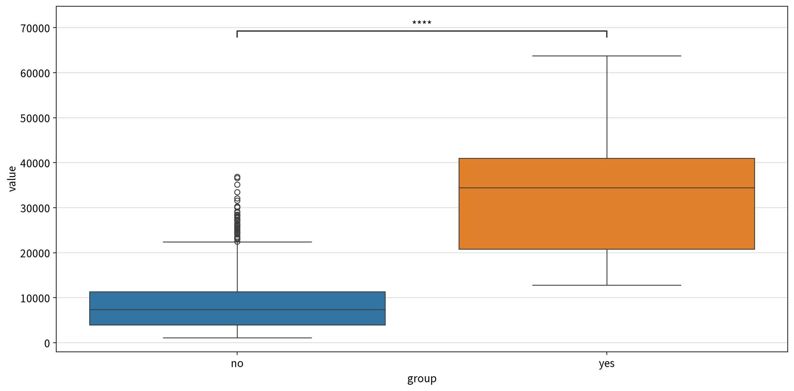
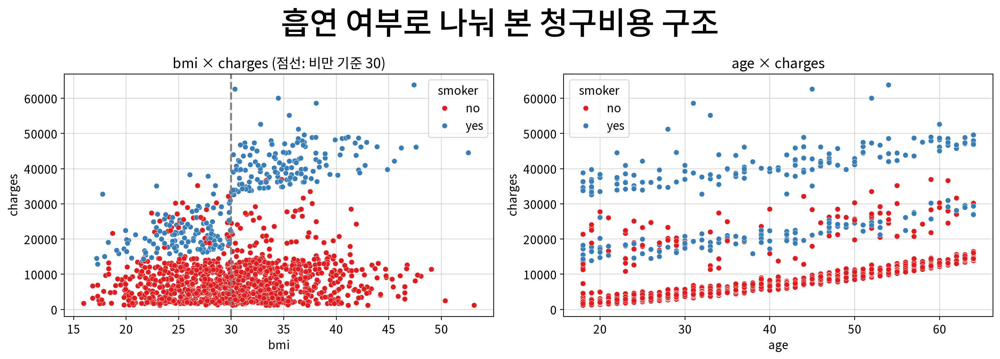
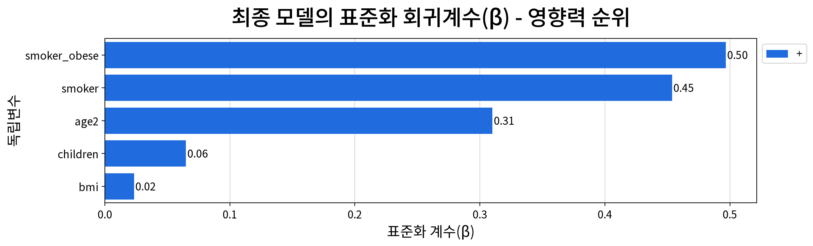

# 🏥 의료보험 청구비용 회귀분석 — '흡연 × 비만' 상호작용을 찾기까지

> 가입자 1,338명의 데이터로 **품질 점검 → EDA → 전처리 조합 비교 → 도메인 파생변수 모델**을 하나의 흐름으로 수행했습니다.
> 기계적 전처리만으로는 R² 0.75에 머물렀지만, EDA에서 발견한 **'흡연자 중 비만인 사람만 비용이 두 배로 뛴다'** 는 구조를 변수로 만들자 **R² 0.864, RMSE −26%** 로 개선됐습니다.

📓 분석 과정 전체(코드 포함) : [보험료 결정요인.ipynb](<보험료 결정요인.ipynb>)

## 📌 핵심 요약

| 항목 | 내용 |
|---|---|
| **데이터** | Medical Insurance · 1,338행 → 중복 1행 제거 후 1,337행 × 7개 변수 |
| **종속변수** | `charges` 연간 의료보험 청구비용 ($) |
| **분석 질문** | ① 청구비용을 결정하는 요인은? ② 로그변환은 항상 도움이 되는가? ③ 흡연과 비만은 따로 작용하는가, 함께 작용하는가? |
| **주요 기법** | Spearman 상관 · Mann-Whitney U · Welch ANOVA · Games-Howell · 상호작용 파생변수 · 후진소거 OLS |

#### ✅ 최종 모델
| 항목 | 값 |
|---|---|
| 형태 | `charges` ~ `smoker` + `smoker_obese` + `age²` + `children` + `bmi` |
| 성능 | **RMSE 4,466** · MAE 2,447 · R² 0.864 |
| 가정 | 선형성 ✅ · 등분산성 ✅ · 독립성 ✅ · 정규성 ❌ |
| 가장 큰 영향 | `smoker_obese` (β = 0.497) |

## 🔍 분석 흐름

1. **PART 1. 데이터 품질 점검** — `my_qtcheck`
2. **PART 2. EDA** — 단변량 → 이변량 → 다변량 · 상호작용 탐색
3. **PART 3. 회귀모델링** — 전처리 체크포인트 비교 → 도메인 파생변수 모델 → 최종 보고

## 💡 핵심 인사이트

### 1. 청구비용을 결정하는 것은 '흡연', 그리고 '흡연 × 비만'이다

- 흡연자는 비흡연자보다 기본 +13,606달러, **비만까지 겹치면 +32,944달러**를 더 청구한다.
- 비흡연자에게 비만은 +879달러(+11%)에 불과하지만 **흡연자에게는 +20,195달러(+95%)** 다. 두 위험요인은 더해지는 것이 아니라 **곱해진다.**

### 2. 기계적 전처리보다 '데이터 구조를 읽는 것'이 더 큰 성과를 냈다

| 접근 | 최고 RMSE | R² |
|---|---|---|
| 기계적 전처리 5단계 (로그·이상치·VIF·스케일링) | 6,059 (기준선) | 0.750 |
| **EDA 기반 파생변수 2개** | **4,466** | **0.864** |
- 로그변환은 오히려 RMSE를 37% 악화시켰다. 문제는 '치우친 분포'가 아니라 **'섞여 있는 집단'** 이었기 때문이다.
- 상호작용항을 넣자 **선형성 · 등분산성 위배가 함께 해소**됐다. 가정 위배는 모델 구조가 틀렸다는 신호였다.

### 3. 성별·지역은 요율 근거가 되지 못한다
- `sex`(p = 0.695), `region`(p = 0.053, 효과크기 무시 수준)은 EDA 단계에서 제외했다.

### ⚠️ 한계
- 성능은 **학습 데이터 기준(in-sample)** 이다. 실제 예측력은 train/test 분할이나 교차검증으로 확인해야 한다.
- 비만 경계(BMI 30)는 WHO 기준을 따른 것으로, 경계를 바꾸면 `smoker_obese`의 효과 크기가 달라질 수 있다.
- 잔차의 정규성이 위배됐다. 흡연·비만·나이로 설명되지 않는 고비용 가입자가 남아 있다는 뜻으로, 병력·사고 이력 등 데이터에 없는 요인일 가능성이 있다.
