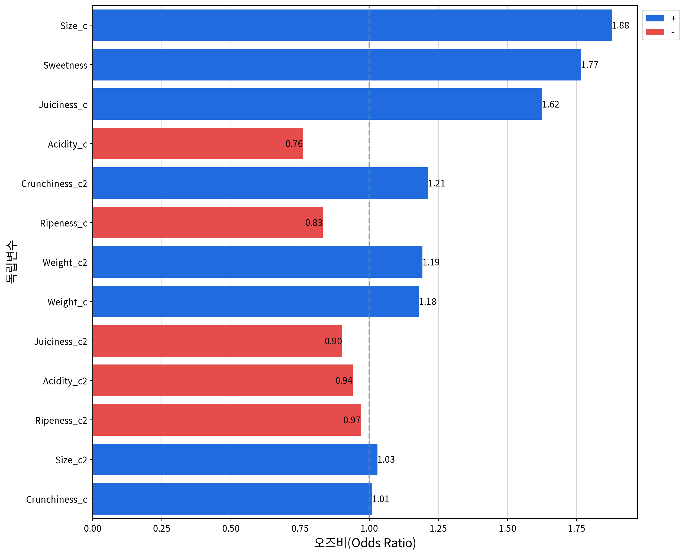
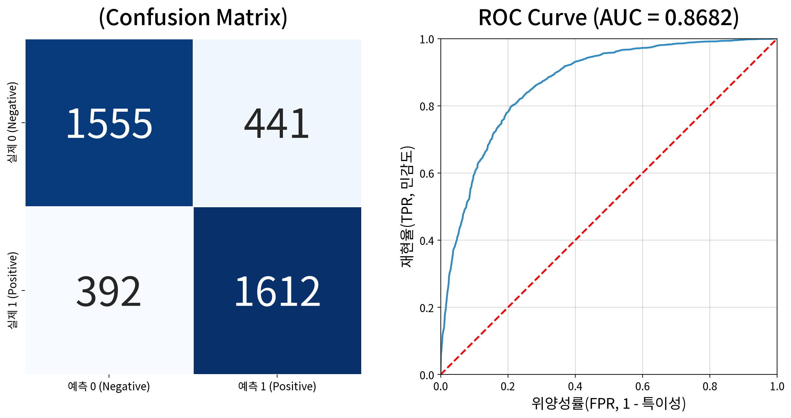

# 🍎 사과 품질 판별 — 로지스틱 회귀

> 사과 4,000개의 7가지 특성(크기 · 무게 · 단맛 · 아삭함 · 과즙 · 숙성도 · 산도)으로 품질(`good` / `bad`)을 판별하는 로지스틱 회귀를
> **품질 점검 → EDA → 기준선 모형 → 가정 검정(로짓 선형성) → 체크포인트 비교 → 최종 보고**의 흐름으로 수행했습니다.
> 직선만 가정한 기준선 모형은 AUC 0.824에 머물렀지만, **가정 검정에서 찾은 곡선 관계(제곱항)를 반영하자 AUC 0.868**로 올라갔습니다.
> 특히 EDA와 기준선 모형에서 모두 '무관'으로 보였던 **아삭함(`Crunchiness`)이 U자 곡선의 강한 예측 변수**로 드러났습니다.

📓 분석 과정 전체(코드 포함) : [사과_품질_판별.ipynb](사과_품질_판별.ipynb)

## 📌 핵심 요약

| 항목 | 내용 |
|---|---|
| **데이터** | Apple Quality (Kaggle) · 4,000행 × 7개 특성 (결측 · 중복 없음, 값은 표준화된 점수) |
| **종속변수** | `Quality` — `good`(2,004) / `bad`(1,996), 거의 완벽한 균형 |
| **분석 질문** | ① 어떤 특성이 사과의 품질을 가르는가? ② 특성과 품질의 관계는 직선인가, 곡선인가? ③ 판별 기준(임계값)은 어떻게 정해야 하는가? |
| **주요 기법** | Welch t / Mann-Whitney U · Box-Tidwell 로짓 선형성 검정 · 제곱항 · 후진소거 · AUC · 임계값 조정 |

#### ✅ 최종 모델

| 항목 | 값 |
|---|---|
| 모델 | `4_가정반영` |
| 형태 | `logit(P(good))` ~ `Sweetness` + 6개 변수의 1차항 · 제곱항 (13개 항) |
| 성능 | 정확도 0.792 · AUC 0.868 · Pseudo R² 0.342 |
| 가장 큰 영향 | `Size` (β = 1.214) |

## 📊 핵심 그래프

**최종 모델의 오즈비(Odds Ratio)**

**혼동행렬과 ROC 곡선 (AUC 0.868)**

## 🔍 분석 흐름

1. **PART 1. 데이터 품질 점검** — 식별자 제거 · 자료형 · 중복 · 결측 · 기술통계
2. **PART 2. EDA** — 단변량 → 이변량(T검정) → 다변량(공선성) → 최종 변수 선택
3. **PART 3. 기준선 모형과 가정 검정** — 기준선 모형 → 로짓 선형성 진단 → 처방 루프 → 독립성
4. **PART 4. 로지스틱 회귀 모델링** — 전처리 체크포인트 비교 → 최종 모델 선택
5. **PART 5. 최종 모델 보고** — 계수 해석 · 분류 성능 · 임계값 조정

## 💡 핵심 인사이트

### 1. 품질을 가르는 3대 축은 크기 · 단맛 · 과즙
- 표준화 계수 β 기준 **`Size`(1.214) > `Sweetness`(1.105) > `Juiciness`(0.937)** 다.
- 산도와 숙성도는 높을수록 품질에 불리하다.

### 2. EDA에서 '무관'이던 변수가 모델에서 살아났다
- `Weight` · `Acidity`는 단독 비교(T검정)에서 차이가 없었지만, 다른 변수를 통제하자 **강하게 유의**해졌다(억제효과).
- `Crunchiness`는 단독 비교와 직선 모형 모두에서 무관했지만, **U자 곡선**이라는 것이 드러나자 강한 예측 변수가 됐다.
- → **EDA에서 유의하지 않다는 이유만으로 변수를 버리면 안 된다.**

### 3. 성능을 올린 것은 전처리가 아니라 가정 검정이었다

| 계열 | AUC | 정확도 |
|---|---|---|
| 직선 가정 (기준선 · 후진소거 · 이상치 대체 · 정규화) | 0.823 ~ 0.824 | 0.749 ~ 0.750 |
| **로짓 선형성 처방 반영 (제곱항)** | **0.868** | **0.792** |

- 이상치 대체 · 정규화는 성능을 거의 바꾸지 못했다. **모형의 구조(직선 vs 곡선)를 바로잡은 것**이 결정적이었다.

### 4. 자동 선택 결과는 분석자가 검토해야 한다
- `compare_models()`가 고른 5번 모델은 제곱항의 짝인 1차항을 지워 계층 원칙을 어겼다. AIC 차이가 1.93에 불과해 **4번(두 항 모두 유지)을 최종 채택**했다.

### 5. 임계값은 목적이 정한다
- 정확도는 임계값 0.5에서 최대(0.792), F1은 0.4에서 최대(0.802)다.
- **프리미엄 선별**(통과시킨 사과는 반드시 `good`) → 임계값을 높여 정밀도 확보, **폐기 판정**(좋은 사과를 버리면 손해) → 임계값을 낮춰 재현율 확보.

### ⚠️ 한계
- **처방 선택이 자동 규칙에 의존한다.** 7종 모두 음수를 포함해 로그 변환이 후보에서 빠졌으므로, 사실상 제곱항 외의 선택지가 없었다. 실제로는 로짓 대비 산점도의 모양을 함께 보고 판단하는 것이 원칙이다.
- **모형이 복잡해졌다.** 제곱항 6개를 추가하면서 변수당 계수가 2개가 되어 오즈비를 한 줄로 해석할 수 없고, 과적합 위험도 올라갔다.
- **성능을 학습 데이터에서 측정했다(in-sample).** 정확도 0.792 · AUC 0.868은 낙관적인 값이며, train/test 분할이나 교차검증으로 확인해야 한다.
- **변수의 물리적 의미를 알 수 없다.** 값이 표준화된 점수로 제공되어 '크기 1점'이 몇 mm인지, '산도 1점'이 pH 얼마인지 알 수 없다.
- **품질 라벨의 기준이 공개되어 있지 않다.** 모형이 학습한 것은 '사과의 객관적 품질'이 아니라 '이 데이터를 만든 사람의 판정 기준'일 수 있다.
- **인과관계가 아니라 연관관계다.** 산도를 인위적으로 낮춘다고 사과가 `good`이 되지는 않는다.
