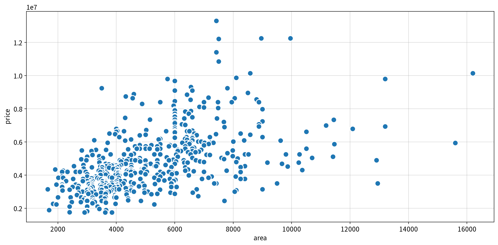
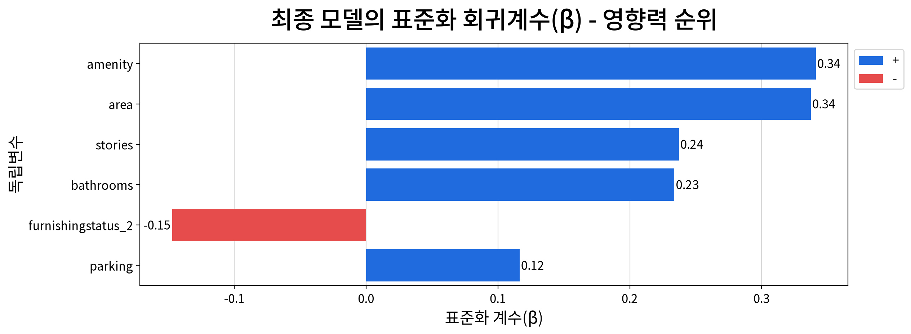
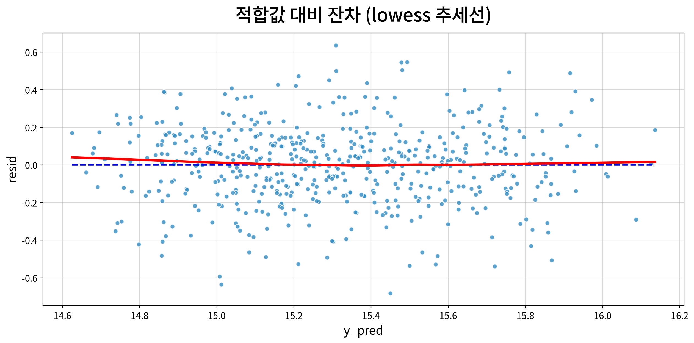

# 🏡 주택 리모델링 가치 분석 — "집을 넓힐까, 설비를 들일까?"

> 주택 545채의 데이터로 **품질 점검 → EDA → 전처리 조합 비교 → 파생변수 모델**을 하나의 흐름으로 수행하고,
> 최종 모델로 **리모델링 의사결정**(면적 확장 vs 설비 추가)에 답했습니다.
> 편의·입지 옵션 6개를 **'보유 개수' 하나로 묶는 파생변수**로 변수를 11개 → 6개로 줄였고,
> **면적을 10% 넓히는 것(+3.1%)보다 옵션 하나를 들이는 것(+11.2%)이 가격에 3배 이상 유리**하다는 결론을 얻었습니다.

📓 분석 과정 전체(코드 포함) : [주택_리모델링_가치_분석.ipynb](주택_리모델링_가치_분석.ipynb)

## 📌 핵심 요약

| 항목 | 내용 |
|---|---|
| **데이터** | Housing · 545행 × 13개 변수 (결측 · 중복 없음) |
| **종속변수** | `price` 주택가격 (단위는 원본 데이터 기준) |
| **분석 질문** | ① 주택가격을 결정하는 요인은? ② 편의 옵션은 '종류'가 중요한가, '개수'가 중요한가? ③ 같은 집이라면 넓히는 것과 설비를 들이는 것 중 무엇이 가격에 유리한가? |
| **주요 기법** | Spearman 상관 · Mann-Whitney U · Welch ANOVA · Games-Howell · 파생변수 · 로그-로그 회귀 · 후진소거 OLS · HC3 |

#### ✅ 최종 모델
| 항목 | 값 |
|---|---|
| 모델 | `7_도메인_이상치대체` |
| 형태 | `log(price)` ~ `log(area)` + `log(bathrooms)` + `log(stories)` + `parking` + `amenity` + 가구 미비치 |
| 성능 | RMSE 1,057,250 · MAE 758,575 · R²(원본 척도) 0.680 |
| 가정 | 선형성 ✅ · 정규성 ✅ · 등분산성 ❌ (HC3 보정) · 독립성 ❌ (행 정렬 영향) |
| 가장 큰 영향 | `amenity` (β = 0.341) ≈ `area` (β = 0.337) |

## 📊 핵심 그래프

**면적(area)과 가격(price)**

**최종 모델의 표준화 회귀계수(β) — amenity와 area가 가장 크다**

**적합값 대비 잔차 (lowess 추세선)**

## 🔍 분석 흐름

1. **PART 1. 데이터 품질 점검** — `my_qtcheck`
2. **PART 2. EDA** — 단변량 → 이변량(옵션 6종 비교) → 다변량(옵션 개수 효과)
3. **PART 3. 회귀모델링** — 전처리 체크포인트 비교 → `amenity` 파생변수 모델 → EDA 판정 vs 모델 결과 → 최종 보고

## 💡 핵심 인사이트

### 1. 가격은 '크기'와 '갖춘 것'이 비슷한 비중으로 결정한다
- 영향력 1·2위가 **편의시설 점수(β = 0.341)** 와 **면적(β = 0.337)** 으로 거의 같다.
- 층수 · 욕실 · 가구 비치 · 주차가 뒤를 잇고, 침실 수는 면적 · 층수에 흡수돼 빠졌다.

### 2. 옵션은 '종류'보다 '개수'
- 보유 옵션이 0개 → 5개로 늘면 가격 중앙값이 약 2.1배가 된다. 옵션 6종 모두 '있는 집'이 유의하게 비쌌다(중앙값 +20~48%).
- 6개 더미를 `amenity` 하나로 묶어 **변수 11개 → 6개**, RMSE는 1위 모델과 2.28% 차이에 그쳤다.

### 3. 리모델링 답변: 넓히기보다 설비 하나
- 최종 모델의 계수로 보면, 옵션을 1개 들이면 가격 **+11.2%**, 면적을 10% 넓히면 약 **+3.1%** 로, 가격 효과는 설비 쪽이 3배 이상 크다.
- 옵션 1개만큼 가격을 올리려면 면적을 **약 40%** 넓혀야 한다(최종 모델의 면적 탄력성 0.316으로 환산 : 1.112^(1/0.316) ≈ 1.40). 현실적인 증축 범위에서는 설비 하나가 더 큰 효과를 낸다.
- 다만 공사 비용은 분석하지 않았으므로, 실제 판단은 각 공사의 비용과 함께 따져야 한다.

### 4. 간명성 규칙의 작동
- RMSE 1위와 5% 이내라면 변수가 적은 모델을 고른다. 성능을 2% 남짓 양보하고 변수를 절반 가까이 줄인 모델이, 설명하고 활용하기에는 더 쓸모 있다.

### ⚠️ 한계
- R² 0.695 — 가격의 약 30%는 **입지 세부 정보 · 건축 연도 · 관리 상태** 같은 데이터에 없는 요인이다.
- `amenity`는 옵션의 **개수**만 세기 때문에, 에어컨이든 지하실이든 효과가 같다고 가정한다. 실제로는 EDA에서 옵션마다 가격 차이가 달랐다(중앙값 +20~48%). 변수를 줄이는 대신 옵션별 차이를 포기한 **단순화**다.
- 관측 데이터의 상관관계이므로, 리모델링을 했을 때의 **인과 효과로 단정할 수 없다.**
- 성능은 모델을 학습시킨 데이터로 평가한 값(in-sample)이다. 처음 보는 데이터에서의 예측력은 train/test 분할이나 교차검증으로 확인해야 한다.
