# 🏘️ 캘리포니아 주택가격 결정요인 분석

> 무엇이 집값을 가르는가? — **소득 · 해안 입지 · 공간 권역**, 세 축이 영향력의 78%

📓 분석 과정 전체(코드 포함) : [캘리포니아 주택가격 결정요인.ipynb](<캘리포니아 주택가격 결정요인.ipynb>)

## 📌 핵심 요약

| 항목 | 결과 |
|---|---|
| 데이터 | [California Housing Prices (Kaggle)](https://www.kaggle.com/datasets/camnugent/california-housing-prices) · 1990년 인구조사 · 20,640개 구역 → 결측 처리 후 20,433개 |
| 종속변수 | `median_house_value` 구역별 주택 중위 가격 (모델링에서는 로그 변환) |
| 최종 모델 | **CatBoost** (투입 변수 7개 · depth 8 · iterations 1000 · learning_rate 0.03) |
| 성능 (평가 데이터 4,087행) | **R² 0.781** · RMSE 0.268 · MAE 0.196 (로그 단위 · 평균 약 ±22% 가격 오차) |
| 일반화 | **일반화 판정** (Gap 14.60% < 15%) · 교차검증 RMSE 0.266 ↔ 평가 RMSE 0.268 |
| 핵심 요인 | `income_per_person`(1인당 소득) · `ocean_area`(해안 입지) · `spatial_cluster`(공간 권역) |

- **피처 엔지니어링** : 방 수 · 인구 같은 총량 변수를 비율로 바꾸자 **1인당 소득(ρ = 0.722)** 이 가장 강한 변수가 됐다.
- **공간 분석** : **Moran's I = 0.790**으로 '이웃끼리 집값이 닮는' 구조를 확인하고, 위경도를 **5개 권역**으로 군집화해 변수로 만들었다.
- **모델 비교** : 회귀 모델 11종을 비교 · 튜닝하고, RMSE 순위만 보지 않고 **근소 격차 그룹 · 보조 지표 결함 · 일반화**까지 확인해 최종 모델을 골랐다. 변수를 30% 줄여도 성능이 유지돼 7개 변수 모델을 택했다.
- **해석** : SHAP으로 소득은 **단조 증가**, 입지는 **내륙이라서 내려가는 폭(약 −24%)이 해안이라서 오르는 폭(약 +12%)의 약 2배**, 주거 구조는 **비선형**(일정 수준을 넘어야 오르는 방 수 · U자인 침실 비율)이라는 것을 확인했다.

<br>

---

## 0. 분석 배경 및 목적

- 집값은 **'어디에 있는가'와 '누가 사는가'** 에 크게 좌우된다고 알려져 있다.
- 이 통념을 데이터로 확인하고, 모델에 넣을 수 있는 **설명 변수**로 만든 뒤 머신러닝으로 예측 · 해석한다.
- 특히 위도 · 경도처럼 그대로는 쓰기 어려운 **위치 정보를 변수로 바꾸는 방법**에 초점을 둔다.

| 연구 질문 |
|---|
| ① 이 모형의 예측을 실무에 쓸 수 있는가? |
| ② 주택가격을 좌우하는 요인은 무엇인가? |
| ③ 그 요인은 어느 방향으로, 어떤 모양으로 작동하는가? |

## 1. 분석 흐름

```
품질 점검 → EDA → 파생변수 · 공간특성 → 파생변수 검증 → 로그 변환 · 라벨링
→ 베이스라인 11종 → 튜닝 → 최종 모델 선정 → 과적합 판정 → 변수 중요도 · 변수 축소 → SHAP 해석
```

---

## 2. 데이터 품질 점검

| 점검 항목 | 결과 | 조치 |
|---|---|---|
| 중복 | 0건 | — |
| 결측 | `total_bedrooms` 207건 (1.0%) | 행 삭제 (20,640 → 20,433) |
| 불가능한 값 | 없음 (0 · 음수 없음) | — |
| 상한 절단 의심 | 집값 최댓값 500,001달러 | 단변량 분석에서 확인 |

- 규모 변수 4종(방 수 · 침실 수 · 인구 · 가구 수)은 평균이 중앙값보다 22 ~ 24% 크고, 집값도 15% 크다. 모두 오른쪽 꼬리가 길다.
- 이상치는 **모두 위쪽에만** 있다(하한 이상치 0%).

## 3. 탐색적 데이터 분석 (EDA)

### 3-1. 종속변수 — 500,001달러에서 잘린 집값

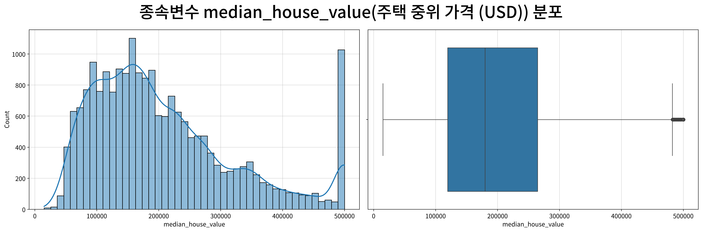

- 우편향(왜도 0.98) — 중앙값 179,700달러 < 평균 206,864달러
- **500,001달러에 958건(4.7%)** 이 몰려 있다. 실제 가격이 아니라 **조사 상한에서 잘린 값**이다.
- 위쪽 이상치 1,064건 중 958건(90%)이 이 값이라, 지우면 고가 구간이 통째로 사라진다 → 지우지 않고 **로그 변환**으로 완화한다.
- 주택 연령 52년(1,265건) · 소득 15.0(50건)에도 값이 몰려 있다 — 같은 상한 절단이다.

### 3-2. 집값과의 관계 — 소득 하나만 기준을 넘었다

| 판정 | 변수 | Spearman ρ |
|---|---|---|
| ✅ 채택 | `median_income` | **+0.677** |
| 🟡 보류 | `total_rooms` · `households` · `total_bedrooms` · `housing_median_age` | +0.075 ~ +0.205 |
| ❌ 제외 | `population` | +0.003 (p = 0.681, 비유의) |

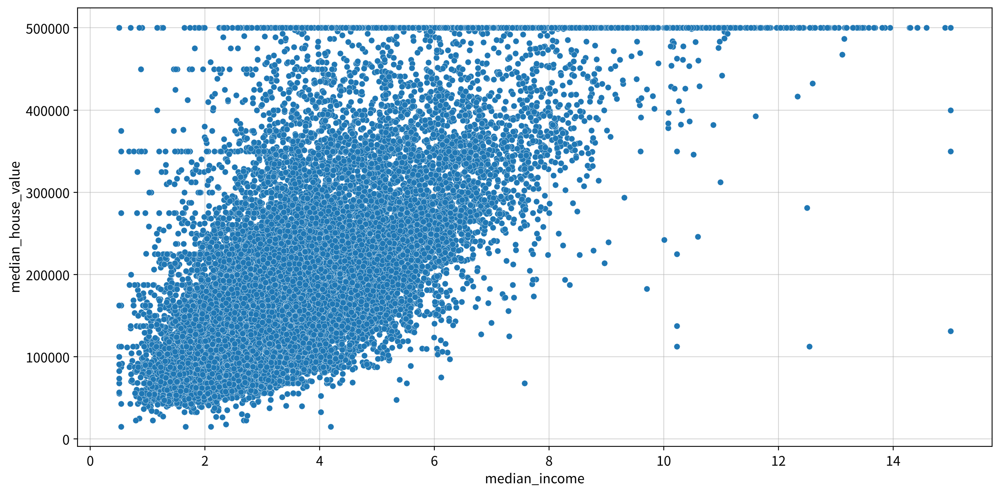

- 규모 변수는 **구역 전체의 합계**라, 집이 많은 구역일수록 커질 뿐 집값을 잘 설명하지 못한다.
- 규모 변수 4종은 서로 **ρ ≥ 0.90**으로 같은 정보를 담고 있다 → **비율로 바꾸는 것**이 다음 과제다.

### 3-3. 해양 근접도 — 실질 구조는 '내륙 vs 해안권'

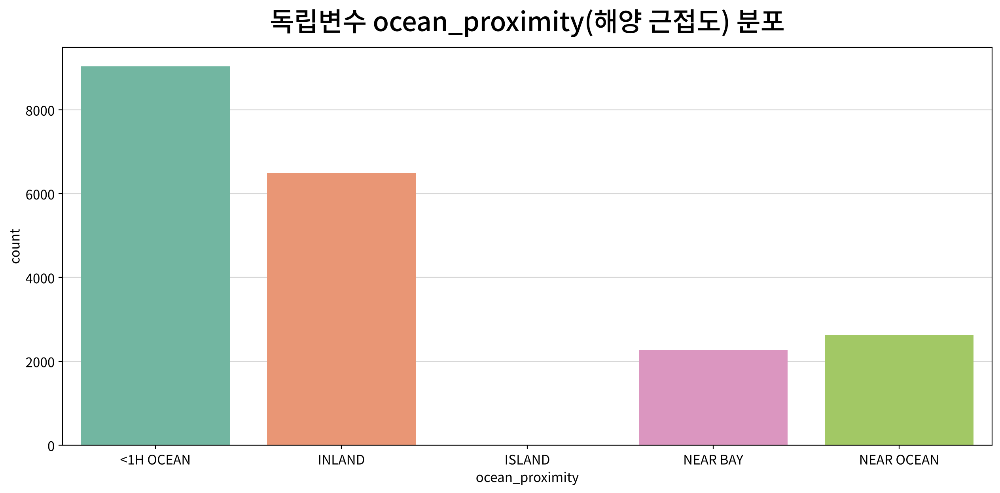

- Welch ANOVA 유의(F = 2,055.8, p < 0.001), 효과크기 **np² = 0.238 (Large)** — 범주형 변수 중 가장 강하다.
- 평균 : `INLAND` 124,897달러 < `<1H OCEAN` 240,268달러 < `NEAR OCEAN` 249,042달러 < `NEAR BAY` 259,279달러
- 해안권 3종끼리는 효과크기가 Negligible → **실질적으로 '내륙 vs 해안권' 2집단**이다. `ISLAND`(5건)는 표본이 작아 판정할 수 없다.

---

## 4. 파생변수 생성

### 4-1. 비율형 · 범주형 파생변수 8종

| 구분 | 파생변수 | 재료 | 의미 |
|---|---|---|---|
| 규모 해제 | `rooms_per_person` | 방 수 ÷ 인구 | 1인당 방 수 |
| 규모 해제 | `rooms_per_household` | 방 수 ÷ 가구 수 | 가구당 방 수 |
| 규모 해제 | `bedrooms_per_room` | 침실 수 ÷ 방 수 | 방 중 침실 비율 |
| 규모 해제 | `population_per_household` | 인구 ÷ 가구 수 | 가구당 인구 |
| 구매력 | `income_per_person` | 중위 소득 ÷ 가구당 인구 | 1인당 소득 |
| 절단 표시 | `is_age_capped` · `is_income_capped` | 주택 연령 ≥ 52 · 소득 ≥ 15.0 | 상한 절단 여부 (0 / 1) |
| 범주 재구성 | `ocean_area` | 해양 근접도 5범주 | 내륙 / 해안권 2범주 |

### 4-2. 공간특성 — 이웃한 구역끼리 집값이 닮았다

| 공간가중치 | Moran's I | p-value | 판정 |
|---|---|---|---|
| Queen | **0.790** | 0.001 | 양의 공간자기상관 유의 |
| Rook | **0.790** | 0.001 | 양의 공간자기상관 유의 |

- 비싼 구역 주변에 비싼 구역이 모여 있는 **Hot Spot 군집형**이다. 위치 정보를 빼면 이 차이를 설명하지 못하므로, 위도 · 경도를 **군집화해 권역 변수**로 만든다.

### 4-3. 공간 군집 — 좌표 2개가 5개 권역이 됐다

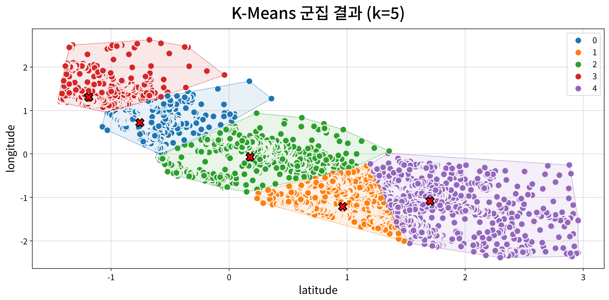

| 권역 | 건수 | 평균 집값 | 중심 좌표 (위도, 경도) |
|---|---|---|---|
| 0 · 남부 해안 (LA 권역) | 8,729 | 230,623달러 | (34.01, −118.13) |
| 1 · 북부 해안 (베이 권역) | 5,639 | **241,487달러** | (37.69, −122.00) |
| 2 · 중부 내륙 (센트럴밸리) | 1,787 | 121,933달러 | (36.01, −119.71) |
| 3 · 최남부 (샌디에이고 권역) | 2,211 | 177,072달러 | (33.09, −116.95) |
| 4 · 북부 내륙 (새크라멘토 이북) | 2,067 | **117,373달러** | (39.27, −121.74) |

- 지표(실루엣)는 k = 2를 골랐지만, '남 / 북' 이분화로는 권역 변수로서 정보가 부족해 **엘보우와 일치하고 실루엣도 0.5 이상(0.581)인 k = 5**를 선택했다.
- 권역 이름은 중심 좌표를 지도와 대조해 붙였다.

## 5. 파생변수 검증

| 판정 | 변수 | 근거 |
|---|---|---|
| ✅ 채택 | `income_per_person` | ρ = +0.722 (**Strong**) — 데이터셋 유일의 Strong. 재료인 `median_income`(0.677)보다 강함 |
| ✅ 채택 | `rooms_per_person` | ρ = +0.400 (Moderate) — 재료인 `total_rooms`(0.205)의 약 2배 |
| ✅ 채택 | `bedrooms_per_room` | ρ = −0.332 (Moderate) — 총량으로는 못 보던 음의 관계 |
| ✅ 채택 | `ocean_area` | Mann-Whitney U 유의 — 해안권 > 내륙, 2범주로 줄여도 차이 유지 |
| ✅ 채택 | `spatial_cluster` | Welch ANOVA, **np² = 0.158 (Large)** — 10쌍 중 9쌍 유의 |
| 🟡 보류 | `rooms_per_household` · `population_per_household` | ρ = +0.263 · −0.256 (Weak) |
| 🟡 보류 | `is_age_capped` | 유의하지만 `housing_median_age`에서 만든 변수라 정보가 겹칠 수 있음 |
| ⚠️ 주의 | `is_income_capped` | 유의하지만 50건뿐이라 추정이 불안정 |

- 비율로 바꾸자 **Moderate 이상인 변수가 1개 → 3개**로 늘었다. '크기' 효과가 집값 신호를 덮고 있었다는 EDA의 판단이 확인됐다.
- 연속형 파생변수 5종은 모두 로그 변환 기준(왜도 ≥ 1 등)을 넘어 **로그 변환**했고, 종속변수도 로그 변환했다(왜도 0.98 → −0.17).
- 투입 후보 **10종** : 원본 `housing_median_age` 1 + 연속형 파생 5 + 범주형 파생 3 + 공간 파생 1

---

## 6. 모델링

### 6-1. 모형 설계

- 학습 80% (16,346행) / 검증 20% (4,087행) · 랜덤 시드 고정
- 평균 · 분포를 쓰는 전처리(스케일링 · VIF 등)는 **학습 데이터로만 기준을 정하고** 검증 데이터에 적용했다(파이프라인) → 데이터 누수 차단

| 계열 | 모델 | VIF | 스케일링 | 인코딩 |
|---|---|---|---|---|
| 선형 | LinearRegression · Ridge | O | Ridge만 O | 더미 (drop_first) |
| 선형 + 규제 | Lasso · ElasticNet | X | O | 더미 (drop_first) |
| 비선형 | KNN · SVR | O | O | 더미 (drop_first) |
| 비선형 · 앙상블 | Decision Tree · Random Forest · XGBoost · LightGBM | O | X | 더미 (모든 범주 유지) |
| 앙상블 | CatBoost | O | X | 자체 범주형 처리 |

### 6-2. 평가 기준 — 최종 선정 4단계 규칙

1. **RMSE**가 낮은 순으로 줄 세운다.
2. 1등과 RMSE 차이가 **5% 이내**인 모델을 '근소 격차 그룹'으로 묶는다.
3. 그룹 안에서 보조 지표가 유독 나쁜 모델을 **결함**으로 센다 (MAE가 1등보다 10% 이상 나쁨 · R²가 0.05 이상 낮음).
4. **결함이 적은 모델을 먼저**, 결함 수가 같으면 **RMSE가 낮은 모델을 먼저** 세운다.

### 6-3. 베이스라인 — 기본 설정으로 11종 비교

| 순위 | 모델 | R² | MAE | RMSE | 그룹 |
|---|---|---|---|---|---|
| 1 | SVR | 0.781 | 0.192 | **0.268** | 근소 격차 |
| 2 | CatBoost | 0.777 | 0.197 | 0.271 | 근소 격차 |
| 3 | LightGBM | 0.773 | 0.200 | 0.273 | 근소 격차 |
| 4 | Random Forest | 0.766 | 0.202 | 0.278 | 근소 격차 |
| 5 | XGBoost | 0.760 | 0.204 | 0.281 | 근소 격차 |
| 6 | KNN | 0.760 | 0.203 | 0.281 | 근소 격차 |
| 7 | LinearRegression | 0.705 | 0.236 | 0.311 | 그룹 외 |
| 8 | Ridge | 0.705 | 0.236 | 0.311 | 그룹 외 |
| 9 | Decision Tree | 0.555 | 0.276 | 0.382 | 그룹 외 |
| 10 | Lasso | 0.000 | 0.463 | 0.574 | 그룹 외 |
| 11 | ElasticNet | 0.000 | 0.463 | 0.574 | 그룹 외 |

- **앙상블 4종과 KNN · SVR, 총 6종이 근소 격차 그룹**에 들었다. 선형 계열은 뚜렷하게 뒤처졌다 — 집값과 변수의 관계가 직선만으로는 설명되지 않는다는 신호다.
- Lasso · ElasticNet의 R² ≈ 0은 기본 규제가 너무 강해 **모든 계수가 0**이 된 상태(평균만 예측)다. Decision Tree는 깊이를 제한하지 않아 과대적합된 것으로 보인다.

### 6-4. 하이퍼파라미터 튜닝 — GridSearchCV · 5-Fold 교차검증

| 모델 | 튜닝 전 RMSE | 튜닝 후 RMSE | 변화 |
|---|---|---|---|
| LinearRegression | 0.311 | 0.311 | ➖ 유지 |
| Ridge | 0.311 | 0.311 | ➖ 유지 |
| Lasso | 0.574 | 0.311 | ✅ 개선 — 규제 강도를 낮추자 회복 |
| ElasticNet | 0.574 | 0.311 | ✅ 개선 — 규제 강도를 낮추자 회복 |
| KNN | 0.281 | 0.275 | ✅ 개선 |
| SVR | 0.268 | 0.287 | ❌ 악화 — 탐색 조합을 1개로 줄인 결과 |
| Decision Tree | 0.382 | 0.296 | ✅ 개선 — 깊이 제한으로 과적합 완화 |
| Random Forest | 0.278 | 0.275 | ✅ 소폭 개선 |
| XGBoost | 0.281 | 0.273 | ✅ 개선 |
| LightGBM | 0.273 | 0.272 | ✅ 소폭 개선 |
| CatBoost | 0.271 | **0.269** | ✅ 소폭 개선 |

### 6-5. 최종 모델 선정 — 튜닝한 CatBoost

| 순위 | 모델 | R² | MAE | RMSE |
|---|---|---|---|---|
| **1** | **CatBoost** | **0.781** | **0.196** | **0.269** |
| 2 | LightGBM | 0.775 | 0.199 | 0.272 |
| 3 | XGBoost | 0.773 | 0.199 | 0.273 |
| 4 | KNN | 0.771 | 0.199 | 0.275 |
| 5 | Random Forest | 0.770 | 0.199 | 0.275 |

- 근소 격차 그룹 5종 중 1위 · 보조 지표 결함 0건 · RMSE 0.271 → 0.269로 개선. 차순위 LightGBM · XGBoost도 대안으로 유효하다.

---

## 7. 신뢰성 검증

### 7-1. 과적합 판정 — 일반화

| 지표 | Train | CV (5-Fold) | Test | Gap% | 판정 |
|---|---|---|---|---|---|
| RMSE | 0.228 | 0.267 (±0.002) | 0.269 | 14.49% | **일반화** (기준 15% 미만) |
| R² | 0.839 | 0.780 | — | — | 과소적합 아님 (≥ 0.3) |

- **CV와 Test의 차이가 0.002**로 작다 → 교차검증으로 추정한 성능이 처음 보는 데이터에서도 재현된다. 다만 격차가 기준에 가까워 여유가 크지는 않다.

### 7-2. 변수 중요도 — 세 축이 68%

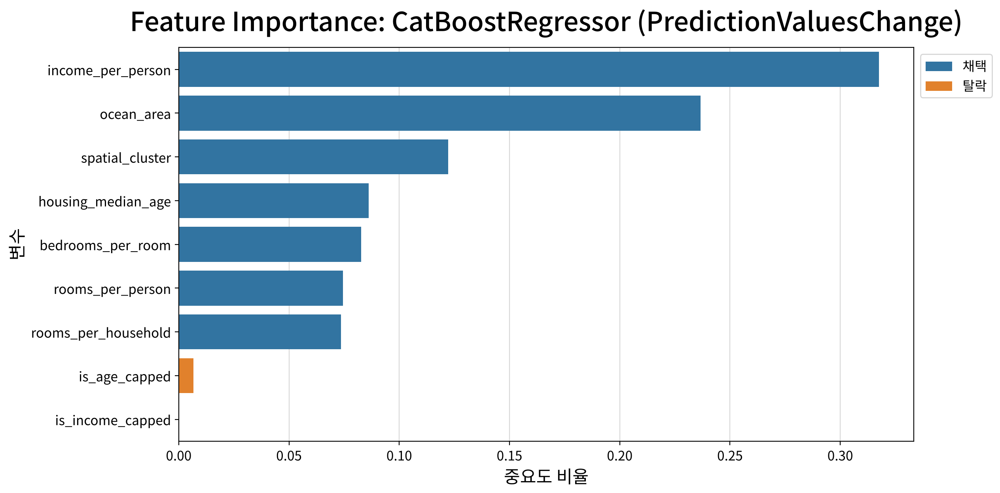

| 변수 | 비율 | 누적 | 판정 |
|---|---|---|---|
| `income_per_person` | 31.7% | 31.7% | 채택 |
| `ocean_area` | 23.7% | 55.4% | 채택 |
| `spatial_cluster` | 12.2% | 67.6% | 채택 |
| `housing_median_age` · `bedrooms_per_room` · `rooms_per_person` · `rooms_per_household` | 7.4 ~ 8.6% | 99.3% | 채택 |
| `is_age_capped` · `is_income_capped` | 0.7% · 0.0% | 100% | 탈락 |

- **상위 3개가 모두 직접 만든 파생변수**다. 특히 1위 · 3위는 원본에 없던 정보(1인당 구매력, 권역)를 새로 만든 변수다.
- `population_per_household`는 모델 안의 **VIF 단계에서 이미 제거**돼 목록에 없다 → 최종 투입 변수 **10개 중 7개**

### 7-3. 변수 축소 재학습 — 7개 변수 모델을 최종 채택

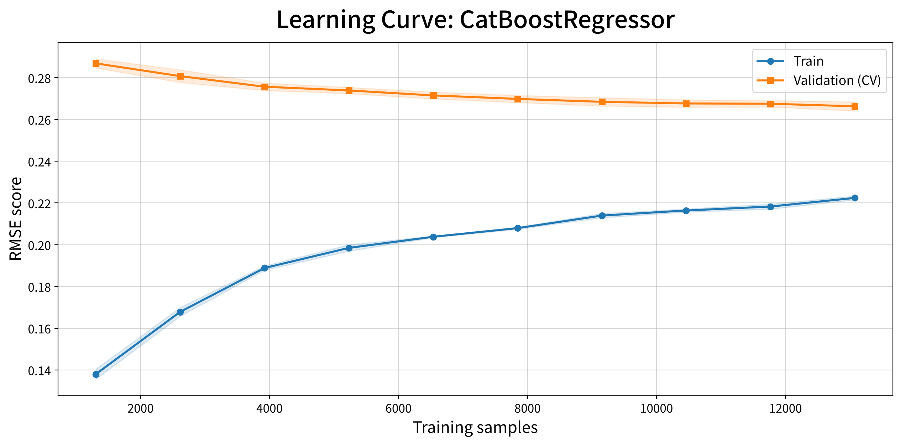

| 점검 항목 | 축소 전 (10개) | 축소 후 (7개) | 판정 |
|---|---|---|---|
| 튜닝 모델 RMSE (Test) | 0.269 | 0.268 | 악화 없음 |
| 튜닝 모델 R² | 0.781 | 0.781 | 유지 |
| 일반화 격차 (Gap%) | 14.49% | 14.60% | 여전히 일반화 |

- 변수를 3개 줄여도 성능과 일반화가 유지돼, **해석이 쉽고 관리할 변수가 적은 7개 변수 모델**을 채택했다.

---

## 8. 모델 해석 (SHAP)

### 8-1. 전역 영향력 — 상위 3개가 78%

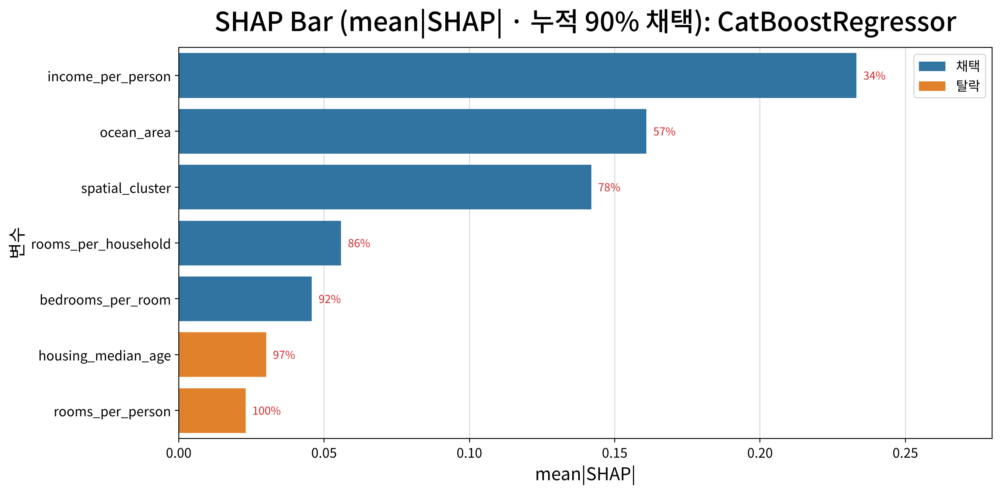

- `income_per_person`(34%) → `ocean_area`(57%) → `spatial_cluster`(78%) — 변수 중요도와 **상위 3개 순서가 같다.** 서로 다른 두 지표가 같은 결론을 낸다.

### 8-2. 방향과 분포 — 불리한 입지의 벌점이 더 크다

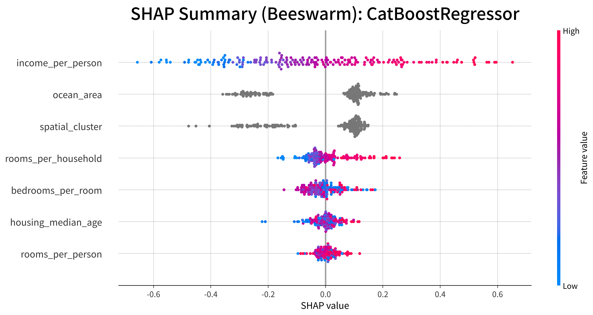

- **소득은 뚜렷한 증가 관계**다(−0.65 ~ +0.65로 가장 넓게 퍼짐).
- **입지는 두 덩어리로 분리**되고, 내리는 쪽이 올리는 쪽보다 크다. 내륙은 약 **−24%**, 해안권은 약 **+12%** 로 벌점이 가점의 약 2배다.
- 하위 4개 변수는 대부분 0 근처(±0.1 안쪽)에 몰려 있어 예측에 주는 영향이 작다.

### 8-3. 권역 효과 — 대도시 해안권만 집값을 올린다

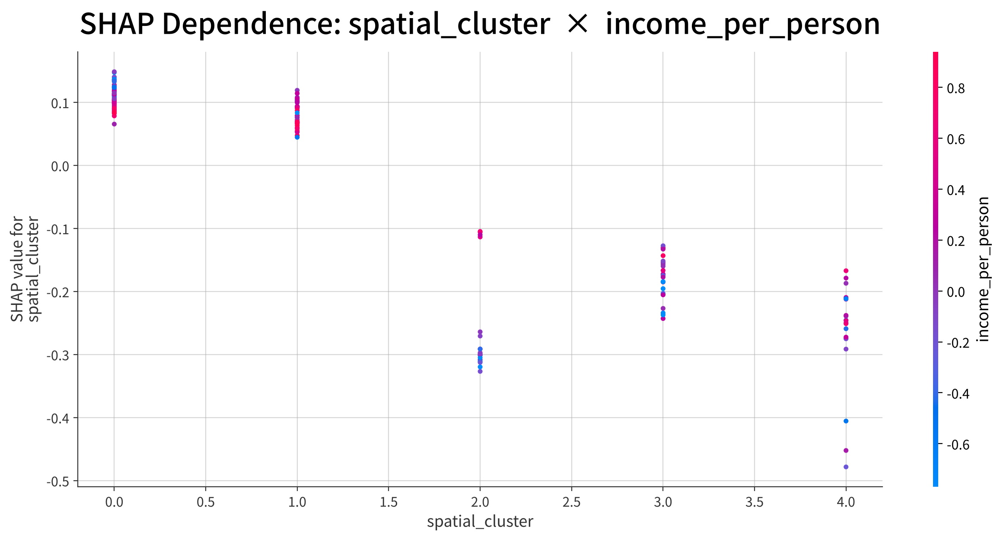

| 권역 | SHAP |
|---|---|
| 0번 LA · 1번 베이 | **올림** (+0.05 ~ +0.15) |
| 2번 센트럴밸리 · 3번 샌디에이고 · 4번 북부 내륙 | **내림** (−0.1 ~ −0.48) |

- 2번 권역에서는 **소득이 높은 구역의 벌점이 작다**(−0.30 → −0.10) — 권역과 소득의 상호작용이다.

### 8-4. 비선형 — 선형 모델로는 잡을 수 없던 모양

| 패턴 | 내용 |
|---|---|
| **방 수의 임계효과** | 가구당 방 수가 로그 값 약 1.8을 넘어야 비로소 집값을 올린다. 그보다 작을 때는 영향이 거의 없다 |
| **침실 비율의 U자** | 침실 비율이 중간인 구역이 오히려 가격에 마이너스이고, 양 끝으로 갈수록 올라간다 |

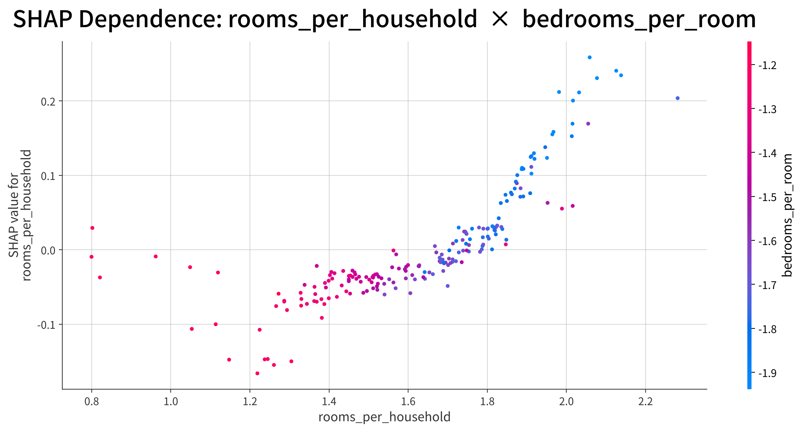

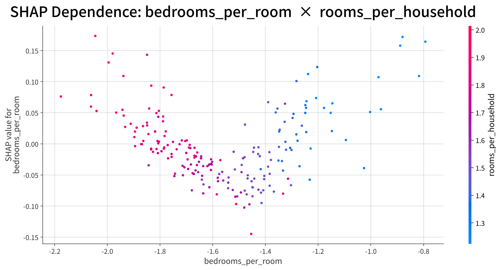

---

## 9. 결론

### 9-1. 연구 질문별 답변

| 질문 | 답 |
|---|---|
| **① 이 모형의 예측을 실무에 쓸 수 있는가?** | **쓸 수 있다.** 일반화 판정을 받았고, 교차검증과 평가 성능이 거의 일치해(0.266 ↔ 0.268) 새 데이터에서도 재현될 것으로 본다. 단, 평균 ±22% 오차를 전제로 한 용도에 한한다 |
| **② 주택가격을 좌우하는 요인은?** | **소득 · 해안 입지 · 공간 권역 세 축**이 지배한다(중요도 67.6% · SHAP 78%). 주거 구조 변수는 미세 조정 역할 |
| **③ 어느 방향, 어떤 모양으로?** | 소득은 **단조 증가**, 입지는 **불연속적 이분**(−24% vs +12%), 주거 구조는 **비선형**(방 수의 임계효과 · 침실 비율의 U자) |

### 9-2. 활용 방안 — 가격대를 좁히고 근거를 제시하는 도구

| 단계 | 활용 | 내용 |
|---|---|---|
| STEP 1 | 1차 스크리닝 | 7개 변수만 넣어 **예상 가격대**를 빠르게 계산하고, 정밀 조사할 지역을 추린다 |
| STEP 2 | 이상치 탐지 | 예상 가격과 **실제 가격이 크게 다른 지역**을 찾아 먼저 확인한다 |
| STEP 3 | 설명 자료 생성 | 지역별 예측 가격을 **SHAP 기여도로 나눠** "왜 이 가격인지" 보여 준다 |

### 9-3. 한계

| 구분 | 한계 |
|---|---|
| 모형 | 학습 ↔ 교차검증 격차 약 15%(기준 안이지만 여유 작음) · 평균 ±22% 오차 → 개별 물건의 가격 확정 용도로는 부적합 · 평가 데이터로 모델을 골라 성능이 약간 낙관적일 수 있음(교차검증 0.266 ↔ 평가 0.268로 차이는 작음) |
| 해석 | SHAP은 **설명이지 인과가 아니다** — "해안이라서 오른다"가 아니라 "모델이 해안 정보를 크게 활용했다" |
| 데이터 | SHAP 표본 200행 중 일부 권역 · 구간은 표본이 적음 · 상한 절단 플래그의 정보 손실 · 로그 단위라 달러로 직접 읽을 수 없음 · 1990년 데이터 |

### 9-4. 후속 과제

1. 표본이 적었던 권역(2번 · 4번)은 원 데이터 규모로 SHAP을 다시 계산하고, 부족하면 해석에서 제외한다.
2. 관측치 확대보다 **새 변수**(접근성 · 공간 특성 등)를 우선 발굴한다.
3. 방 수의 임계효과와 침실 비율의 U자가 **다른 표본에서도 재현되는지** 검증한다.
4. 인과 해석이 필요하면 SHAP이 아니라 **별도의 인과 추론 설계**를 적용한다.
