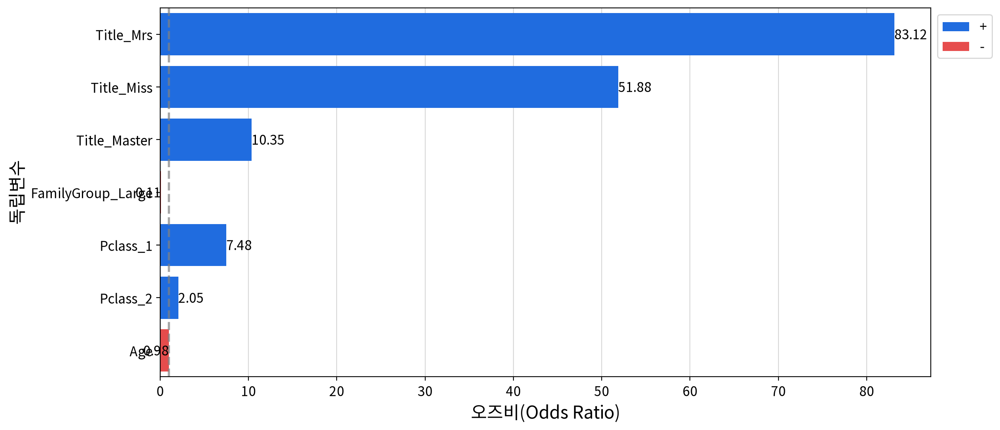

# 🚢 타이타닉 생존 요인 분석 — 로지스틱 회귀

> 타이타닉 승객 1,309명의 데이터로 생존 여부를 판별하는 로지스틱 회귀를
> **품질 점검 → EDA → 기준선 모형 → 가정 검정 → 체크포인트 비교 → 최종 보고**의 흐름으로 수행했습니다.
> 이름에서 뽑은 **호칭(Title)** 으로 '여성과 아이 먼저'를 성별보다 정확하게 포착했고,
> 가족 규모를 **단독 · 소가족 · 대가족**으로 나눈 도메인 파생변수로 대가족의 낮은 생존율을 모델에 담았습니다.

📓 분석 과정 전체(코드 포함) : [타이타닉 생존 요인 분석.ipynb](<타이타닉 생존 요인 분석.ipynb>)

## 📌 핵심 요약

| 항목 | 내용 |
|---|---|
| **데이터** | [Titanic (Kaggle)](https://www.kaggle.com/c/titanic) · 1,309행 → 결측 처리 후 1,306행 |
| **종속변수** | `Survived` — 생존(1) 492명 / 사망(0) 814명 (38 : 62, 약한 불균형) |
| **분석 질문** | ① 누가 살아남았는가? ② '여성과 아이 먼저'는 데이터에서 어떻게 드러나는가? ③ 가족과 함께 탄 것은 생존에 유리했는가? |
| **주요 기법** | 파생변수(호칭 · 가족 규모) · Mann-Whitney U · 카이제곱 검정 · Box-Tidwell · 후진소거 · AUC · 임계값 조정 |

#### ✅ 최종 모델
| 항목 | 값 |
|---|---|
| 모델 | `5_도메인+후진소거` |
| 형태 | `logit(P(생존))` ~ `Title`(Master · Miss · Mrs) + `Pclass`(1 · 2등급) + `FamilyGroup_Large` + `Age` |
| 성능 (임계값 0.5) | 정확도 0.872 · AUC 0.904 · 재현율 0.783 · Pseudo R² 0.476 |
| 권장 임계값 | 0.4 → 정확도 0.873 · F1 0.826 |
| 가장 큰 영향 | `Title_Mrs` (β = 1.592) |

## 🔍 분석 흐름

1. **PART 1. 데이터 품질 점검** — 결측 처리 · 파생변수(가족 수 · 호칭) · 불필요 컬럼 제거
2. **PART 2. EDA** — 단변량 → 이변량(T검정 · 교차분석) → 다변량(공선성) → 최종 변수 선택
3. **PART 3. 기준선 모형과 가정 검정** — 기준선 모형 → 로짓 선형성 · 독립성
4. **PART 4. 로지스틱 회귀 모델링** — 가족 규모 도메인 파생변수 → 체크포인트 비교 → 최종 모델 선택
5. **PART 5. 최종 모델 보고** — 계수 해석 · 분류 성능 · 임계값 조정

## 💡 핵심 인사이트

### 1. 생존을 가른 것은 '여성과 아이' → 객실 등급 → 대가족

- 표준화 계수 β 기준 **기혼 여성(1.592) · 미혼 여성(1.584) > 1등급(0.866) > 대가족(−0.543) > 남자아이(0.493)** 순이다.
- 기혼 여성의 생존 오즈는 성인 남성의 약 83배, 1등급은 3등급의 약 7.5배였고, 대가족은 약 89% 낮았다.

### 2. 호칭(Title)이 성별보다 많은 것을 말했다

- 성별로는 남자아이가 성인 남성(생존율 12.9%)과 같은 집단이었지만, 호칭으로 떼어 보니 **37.7%** 였다.
- 호칭으로 아이를 통제하자, EDA에서 무관했던 **나이의 효과**(1살 ↑ → 생존 오즈 1.7% ↓)도 드러났다.

### 3. 통계 검정이 놓친 모양을 도메인 지식으로 담았다
- 가족 규모는 4명까지 생존율이 오르다 5명부터 급락했지만, 로짓 선형성 검정은 위배를 잡지 못했다.
- 단독 · 소가족 · 대가족으로 나눈 **`FamilyGroup`** 을 쓰자, 같은 변수 7개로 AIC가 940.00 → 923.33으로 낮아졌다.

### 4. 요금 · 항구의 효과는 객실 등급과 겹쳤을 가능성이 있다
- 단독으로는 유의했던 `Fare` · `Embarked`가 다른 변수와 함께 넣자 사라졌다. 요금 · 항구의 정보가 **객실 등급과 겹쳤을 가능성**이 있다.

### 5. 자동 선택은 전처리의 의미를 모른다
- `compare_models()`는 이상치 대체까지 한 모델을 골랐지만, 성능이 같다면 **불필요한 전처리는 빼는 게 맞다.** 전처리가 없는 `5_도메인+후진소거`를 최종 채택했다.

### ⚠️ 한계
- **`Age` 결측 263명(20.1%)을 전체 중앙값(28세)으로 채웠다.** 28세 자리에 인공적인 봉우리가 생겼고, 나이를 모르는 남자아이 8명도 28세로 채워졌다. 호칭별 중앙값 등으로 채우면 더 정확할 수 있다.
- **`Cabin`(선실 정보)을 버렸다.** 77.5%가 비어 있었지만, 기록 여부 자체가 객실 위치 · 등급과 관련된 정보였을 수 있다.
- **`Officer`(23명) 등 작은 범주의 추정은 불안정하다.**
- **성능을 학습 데이터에서 측정했다(in-sample).** train/test 분할이나 교차검증으로 확인해야 한다.
- **인과관계가 아니라 연관관계다.**
