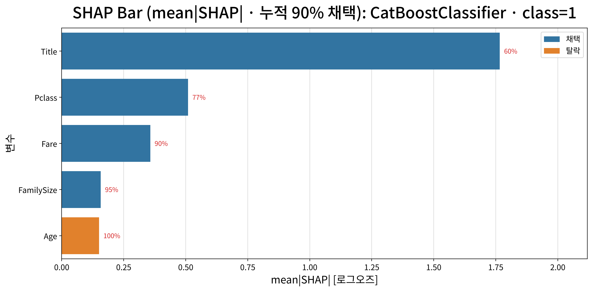
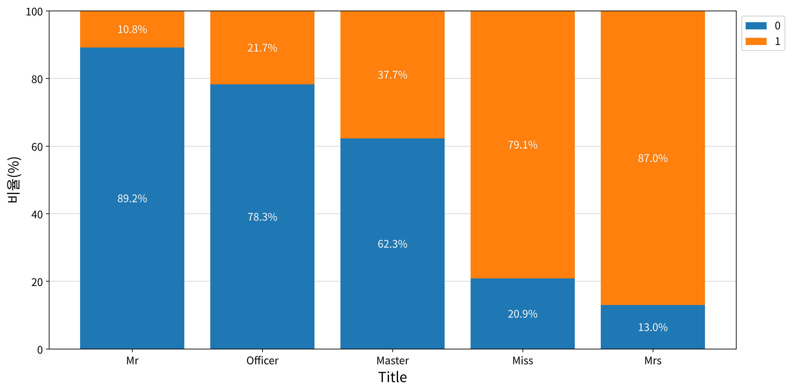
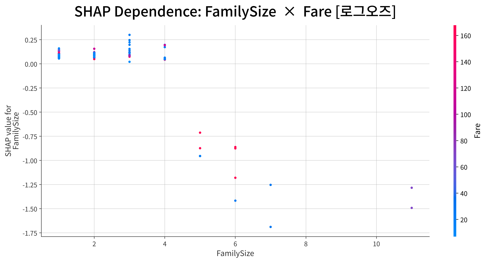
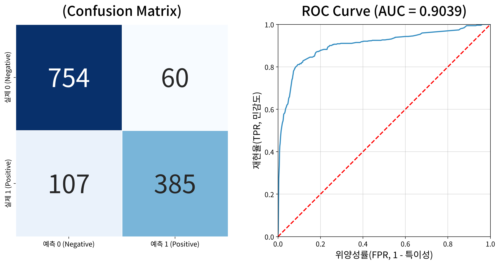

# 🚢 타이타닉 생존 요인 분석 — 로지스틱 회귀 · 머신러닝(CatBoost)

> 타이타닉 승객 1,309명의 데이터로 생존 여부를 분석했습니다.
> **로지스틱 회귀로 생존 요인을 해석**하고, **같은 데이터로 분류 모델 11종을 비교해 처음 보는 데이터에서의 예측 성능을 검증**했습니다.
> 이름에서 뽑은 **호칭(Title)** 으로 '여성과 아이 먼저'를 성별보다 정확하게 포착했고, 가족 규모를 **단독 · 소가족 · 대가족**으로 나눈 도메인 파생변수로 대가족의 낮은 생존율을 모델에 담았습니다.
> 최종 CatBoost는 Test **F1 0.848 · ROC_AUC 0.927**로 일반화 판정을 받았고, SHAP은 가족 규모의 경계를 로지스틱 회귀에서 정한 기준(5명 이상)과 **같은 위치**에서 찾아냈습니다.

📓 분석 과정 전체(코드 포함) : [타이타닉 생존 요인 분석.ipynb](<타이타닉 생존 요인 분석.ipynb>)

## 📌 핵심 요약

| 항목 | 내용 |
|---|---|
| **데이터** | [Titanic (Kaggle)](https://www.kaggle.com/c/titanic) · 1,309행 → 결측 처리 후 1,306행 |
| **종속변수** | `Survived` — 생존(1) 492명 / 사망(0) 814명 (38 : 62, 약한 불균형) |
| **분석 질문** | ① 누가 살아남았는가? ② '여성과 아이 먼저'는 데이터에서 어떻게 드러나는가? ③ 가족과 함께 탄 것은 생존에 유리했는가? |
| **주요 기법** | 파생변수(호칭 · 가족 규모) · Mann-Whitney U · 카이제곱 검정 · Box-Tidwell · 후진소거 · 임계값 조정 · 분류 모델 11종 · GridSearchCV · 과적합 진단 · Feature Importance · SHAP |

#### ✅ 최종 모델

| 구분 | 로지스틱 회귀 (해석용) | CatBoost (예측용) |
|---|---|---|
| 모델 | `5_도메인+후진소거` | CatBoost (`depth` 4 · `iterations` 500 · `learning_rate` 0.03) |
| 데이터 | 1,306행 전체 | 같은 1,306행 (Train 1,044 · Test 262, 80 : 20) |
| 투입 변수 | `Title`(Master · Miss · Mrs) · `Pclass`(1 · 2등급) · `FamilyGroup_Large` · `Age` | `Title` · `Pclass` · `Fare` · `FamilySize` · `Age` (5개) |
| 성능 | 정확도 0.872 · AUC 0.904 · Pseudo R² 0.476 (학습 데이터, 임계값 0.5) | Test F1 0.848 · ROC_AUC 0.927 · CV F1 0.804 |
| 일반화 | — | 일반화 판정 (F1 Gap 2.38%) |
| 가장 큰 영향 | `Title_Mrs` (β = 1.592) | `Title` (SHAP 60.1%) |

## 🔍 분석 흐름

**로지스틱 회귀 — 해석**
1. **PART 1. 데이터 품질 점검** — 결측 처리 · 파생변수(가족 수 · 호칭) · 기술통계
2. **PART 2. EDA** — 단변량 → 이변량(Mann-Whitney U · 교차분석) → 다변량(공선성) → 최종 변수 선택
3. **PART 3. 기준선 모형과 가정 검정** — 모델링용 데이터 저장 → 기준선 모형 → 로짓 선형성 · 독립성
4. **PART 4. 로지스틱 회귀 모델링** — 가족 규모 도메인 파생변수 → 체크포인트 비교 → 최종 모델 선택
5. **PART 5. 최종 모델 보고** — 계수 해석 · 분류 성능 · 임계값 조정

**머신러닝 — 예측과 검증** (PART 3에서 저장한 같은 데이터 사용)

6. **PART 6. 베이스라인 모델 11종** — 기본 설정으로 학습 · 비교
7. **PART 7. 하이퍼파라미터 튜닝** — GridSearchCV · 5-Fold 교차검증
8. **PART 8. 과적합 진단 · 변수 중요도** — 상위 2개 모델 과적합 판정 → Feature Importance → 변수 축소 재학습
9. **PART 9. SHAP 분석** — 전역 영향력 · Dependence Plot

## 💡 핵심 인사이트

### 1. 생존을 가른 것은 '여성과 아이' → 객실 등급 → 대가족

- 로지스틱 회귀의 표준화 계수 β 기준 **기혼 여성(1.592) · 미혼 여성(1.584) > 1등급(0.866) > 대가족(−0.543) > 남자아이(0.493)** 순이다.
- 기혼 여성의 생존 오즈는 성인 남성의 약 83배, 1등급은 3등급의 약 7.5배였고, 대가족은 약 89% 낮았다.

- CatBoost의 SHAP도 **`Title` 60.1% > `Pclass` 17.3% > `Fare` 12.1%** 순이다. 방법이 다른 두 모델이 모두 **신분(호칭)을 가장 큰 요인, 객실 등급을 그다음 요인**으로 꼽았다.

### 2. 호칭(Title)이 성별보다 많은 것을 말했다

- 성별로는 남자아이가 성인 남성과 같은 집단이었지만, 호칭으로 떼어 보니 생존율이 **Master 37.7% vs Mr 10.8%** 로 약 3.5배 차이 났다.
- 호칭으로 아이를 통제하자, EDA에서 무관했던 **나이의 효과**(1살 ↑ → 생존 오즈 1.7% ↓)도 드러났다.

### 3. 사람이 정한 가족 규모 기준을 모델이 스스로 다시 찾았다

- 가족 규모는 4명까지 생존율이 오르다 5명부터 급락했지만, 로짓 선형성 검정은 위배를 잡지 못했다. 그래서 로지스틱 회귀에서는 단독 · 소가족(2 ~ 4명) · 대가족(5명 이상)으로 나눈 **`FamilyGroup`** 을 만들었고, 같은 변수 7개로 AIC가 940.00 → 923.33으로 낮아졌다.
- 머신러닝에는 이 구간을 알려 주지 않고 숫자 `FamilySize`만 넣었다. 그런데 SHAP은 **1 ~ 4명 +0.02 ~ +0.30, 5명부터 −0.71 ~ −1.69**로, `FamilyGroup`의 대가족 기준과 **같은 4명과 5명 사이**에서 한꺼번에 떨어졌다.

### 4. 처음 보는 데이터에서도 성능이 유지됐고, 선형 모델도 비슷했다

- 로지스틱 회귀는 학습에 쓴 데이터로 성능을 재서(in-sample) 새 데이터에서의 성능을 알 수 없었다. 머신러닝에서는 Test 262행과 5-Fold 교차검증으로 확인했고, 최종 CatBoost는 Test F1 0.848 · CV F1 0.804, Gap 2.38%로 **일반화** 판정이다.
- 베이스라인 1위는 기본 설정의 로지스틱 회귀(CatBoost와 F1 0.848로 같음), 튜닝 후 1위는 선형 모델 ElasticNet(CatBoost와 F1 0.857로 같음)이었다. 이 데이터에서는 **선형 모델도 트리 모델과 비슷한 성능**을 냈다.
- CatBoost는 성능 우위가 아니라, 동률에서 **CV ROC_AUC가 조금 높고(0.901 vs 0.890)** 꺾이는 모양을 확인할 수 있어서 골랐다.

### 5. 자동 선택 결과는 분석자가 검토했다
- 로지스틱 회귀 : `compare_models()`는 이상치 대체까지 한 모델을 골랐지만, 성능이 같아 **불필요한 전처리가 없는 `5_도메인+후진소거`** 를 채택했다. 정규화하면 "1살 많으면 생존 오즈 1.7% 감소" 같은 원래 단위의 해석이 어려워진다.
- 머신러닝 : 튜닝 1 · 2위는 Test 지표가 같아서, Test 점수가 아니라 **교차검증 결과**로 최종 모델을 골랐다.

### 6. `Fare` · `Embarked`의 정보는 다른 변수와 겹쳤을 가능성이 있다
- 로지스틱 회귀에서 단독으로는 유의했던 `Fare` · `Embarked`가 다른 변수와 함께 넣자 사라졌다.
- CatBoost에서도 `Embarked`는 변수 중요도 기준(누적 90%)에서 빠졌다. 반면 `Fare`는 SHAP 3위(12.1%)로 쓰여, 두 모델이 `Fare`를 다르게 봤다. 왜 차이가 났는지는 따로 검증하지 않았다.

### ⚠️ 한계
- **`Age` 결측 263명(20.1%)을 전체 중앙값(28세)으로 채웠다.** 나이를 모르는 남자아이 8명도 28세가 됐다. 두 모델이 같은 데이터를 써서 이 한계를 함께 가진다.
- **`Cabin`(선실 정보)을 버렸다.** 77.5%가 비어 있었지만, 기록 여부 자체가 객실 위치 · 등급과 관련된 정보였을 수 있다.
- **`Officer`(23명) 등 작은 범주의 추정은 불안정하다.**
- **로지스틱 회귀의 성능은 학습 데이터에서 측정했다(in-sample).** 최종 로지스틱 모델 자체를 Test로 채점하지는 않았다.
- **모델 후보를 고르는 데 Test 데이터를 썼다.** 순위표를 Test 점수로 매겨 후보를 골랐기 때문에, 같은 Test로 잰 최종 점수(F1 0.848)는 실제보다 조금 좋게 나왔을 수 있다. Test를 쓰지 않은 CV F1은 0.804다.
- **SHAP은 `my_ml.shap_analysis` 기본값대로 200명 표본으로 계산했다.** 가족 5명 이상은 12명뿐이라 그 구간의 수치는 대략적인 값으로만 본다.
- **SHAP · 회귀계수는 인과가 아니다.** "Mr이라서 사망했다"가 아니라 "모델이 Mr인 승객의 생존 예측을 크게 낮췄다"가 정확한 표현이다.
